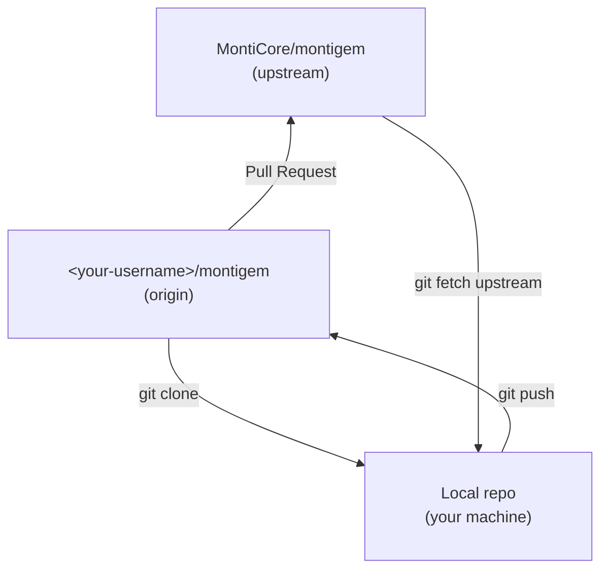
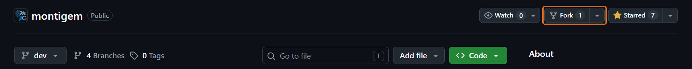
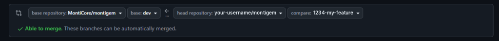
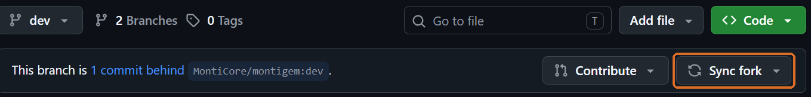

# Working with a Fork – Guide

This guide explains how to contribute changes to this repository via a **fork**.

---

## 1. Terms

| Term | Meaning |
|---|---|
| **This repo** | Where your changes should end up: `github.com/MontiCore/montigem` |
| **Fork** | Your own copy of this repo on GitHub: `github.com/<your-username>/montigem` |
| **Local repo** | The clone on your machine |
| **`origin`** | Remote name for your fork (this is where you push) |
| **`upstream`** | Remote name for this repo (this is where you fetch updates from) |
| **Pull Request (PR)** | A request to the maintainers of this repo to accept your changes |



**Important:** Without write access you **cannot push directly** to this repo.
The path is always: *Fork → Branch → Push → Pull Request*.

---

## 2. One-time setup

### 2.1 Create the fork
Click **Fork** in the top right of this repo's GitHub page.



### 2.2 Clone the fork
```bash
git clone git@github.com:<your-username>/montigem.git
cd montigem
```
This automatically makes `origin` point to your fork.

(Without an SSH key set up on GitHub, clone via HTTPS instead:
`git clone https://github.com/<your-username>/montigem.git`)

### 2.3 Add this repo as `upstream`
```bash
git remote add upstream https://github.com/MontiCore/montigem.git
git fetch upstream
```

Check:
```bash
git remote -v
# origin    git@github.com:<your-username>/montigem.git (fetch/push)
# upstream  https://github.com/MontiCore/montigem.git (fetch/push)
```

---

## 3. Starting a new change

### 3.1 Always use a separate branch
Do not work directly on `dev` (or `main`)! One branch per topic/ticket, e.g. with the ticket number:

```bash
git fetch upstream
git switch --no-track -c 1234-my-feature upstream/dev
```

This way the branch starts from the **latest state of this repo**, not from a possibly outdated fork.

### 3.2 Make and commit your changes
```bash
git add <files>
git commit -m "Short, meaningful description"
```

---

## 4. Pushing and creating a pull request

### 4.1 Push the branch to your fork
```bash
git push -u origin 1234-my-feature
```

### 4.2 Open a pull request
**Option A – in the browser:**
1. Open this repo on GitHub: https://github.com/MontiCore/montigem
2. Click **"Compare & pull request"** in the banner above the file list

   

   The banner only appears for a while after you push (about an hour), and only for you.
   **If it's not there**, open the pull request manually:
  - Go to the **Pull requests** tab → **New pull request**
  - Click **compare across forks**
  - Select the four dropdowns as described in step 3

   Or open this URL directly (replace the placeholders):
   `https://github.com/MontiCore/montigem/compare/dev...<your-username>:montigem:1234-my-feature`

3. Check the settings:
  - **base repository:** `MontiCore/montigem` – **base:** `dev`
  - **head repository:** `<your-username>/montigem` – **compare:** `1234-my-feature`

   

4. Enter a title + description → **Create pull request**
   (or **Create draft pull request** if it isn't finished yet)

**Option B – in the terminal (GitHub CLI):**
```bash
gh pr create --repo MontiCore/montigem --base dev --head <your-username>:1234-my-feature
```

---

## 5. After the pull request

- **Review:** Maintainers look at the PR and may leave comments.
- **Follow-up changes:** Just keep committing and pushing on the same branch –
  the PR updates automatically:
  ```bash
  git commit -m "Address review feedback"
  git push
  ```
- **Merge:** Once everything is fine, a maintainer merges the PR into this repo.
- **Clean up:** Update your `dev` first (see section 6), then delete the branch:
  ```bash
  git fetch upstream
  git switch dev
  git merge --ff-only upstream/dev
  git branch -d 1234-my-feature
  git push origin --delete 1234-my-feature
  ```
  If `-d` complains that the branch is "not fully merged" (happens when the PR was
  squash- or rebase-merged), use `git branch -D 1234-my-feature` – but only once the PR is merged.

---

## 6. Keeping the fork up to date

This repo keeps evolving – your fork does not update automatically. Sync regularly:

```bash
git fetch upstream
git switch dev
git merge --ff-only upstream/dev
git push origin dev
```

Alternatively, on GitHub in your fork: **Sync fork** → **Update branch**.
Afterwards, run `git fetch origin` and `git merge --ff-only origin/dev` on `dev` locally to pull the update to your machine.



### Updating a branch you're working on
If `upstream/dev` has changed while you're working on your branch:
```bash
git fetch upstream
git switch 1234-my-feature
git rebase upstream/dev        # or: git merge upstream/dev
git push --force-with-lease    # only needed after a rebase
```

---

## 7. Summary

```bash
# one-time
git remote add upstream https://github.com/MontiCore/montigem.git

# per change
git fetch upstream
git switch --no-track -c <ticket>-<topic> upstream/dev
# ... work, commit ...
git push -u origin <ticket>-<topic>
# → PR on GitHub: <your-username>:<branch>  →  MontiCore/montigem:dev
```

### Common mistakes
| Problem | Solution |
|---|---|
| Worked directly on `dev` | `git switch -c new-branch` – your commits come along; then reset `dev`: `git switch dev && git reset --hard upstream/dev` (if you already pushed `dev` to your fork, also run `git push --force-with-lease origin dev`) |
| PR shows unrelated/old commits | Branch was created from an outdated state → `git rebase upstream/dev` |
| `rejected – non-fast-forward` on push | After a rebase: `git push --force-with-lease` |
| PR targets the fork instead of this repo | When creating it, set **base repository** to `MontiCore/montigem` |
