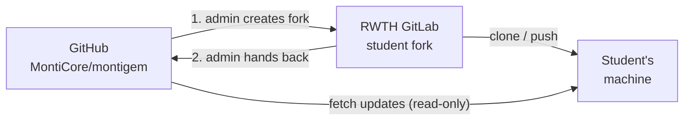

# Student Contributions

This page is for **students** who extend MontiGem as part of a thesis (or a lab/seminar) and for
the **admins** who supervise that work.

Students do not work on GitHub directly. Instead, the admins create a **fork in the RWTH GitLab**
for each student. The student works there for the whole thesis. At the end, the admins bring the
result back to the [GitHub repository](https://github.com/MontiCore/montigem) as one pull request.



The other rules in [CONTRIBUTING.md](https://github.com/MontiCore/montigem/blob/dev/CONTRIBUTING.md) (project structure, testing, coding guidelines) apply to student work as well.

---

## For students

### 1. Getting started

You get access to a GitLab project from your supervisor. It contains two branches:

| Branch              | Purpose |
|---------------------|---|
| `dev`               | A copy of GitHub's `dev` at the time the fork was created. **Never commit to it.** |
| `ba-...` / `ma-...` | **Your** branch. All your work goes here. |

Clone the fork and add the GitHub repository as a second, read-only remote called `upstream`:

```bash
git clone git@git.rwth-aachen.de:<group>/<your-project>.git
cd <your-project>
git switch thesis/<your-name>

git remote add upstream https://github.com/MontiCore/montigem.git
git fetch upstream
```

You never push to `upstream` (you do not have the rights to), you only fetch from it.

### 2. While you work

- **Commit regularly** and write meaningful messages, they help you and your supervisor.
- **Push regularly** to your branch on GitLab. That is your backup, and the GitLab pipeline builds and tests every push.
- **Keep the pipeline green.** A red pipeline that stays red for weeks makes the hand-back much
  harder. If a failure is not caused by you, tell your supervisor.
- **Only framework changes belong in the fork.** Your thesis text, evaluation data, survey
  results, etc. go into a separate repository. Example applications that show your feature are
  welcome, in `examples/` (see the project structure in `CONTRIBUTING.md`).
- **Write tests and documentation** as described in `CONTRIBUTING.md`. Untested or undocumented
  features cannot be handed back.
- **Found an unrelated bug in MontiGem?** Tell your supervisor instead of fixing it on your
  branch. Small, independent fixes can be handed back to GitHub early and separately.

### 3. Staying up to date

MontiGem keeps evolving while you write your thesis. Pull in the latest changes from GitHub
**regularly - at least every two to four weeks.** The longer you wait, the more conflicts you
will have to solve at once.

```bash
git fetch upstream
git switch thesis/<your-name>
git merge upstream/dev
# solve conflicts, run the build, then:
git push
```

### 4. Finishing your thesis

Before you hand in, prepare your branch for the hand-back:

1. Merge the latest `upstream/dev` one last time (see 3.) and make sure the pipeline is green.
2. Remove everything that should not go to GitHub: debug code, commented-out code, local
   configuration, thesis-only files.
3. Write a summary for the pull request in `HANDOVER.md` at the repository root, following the
   [PR template](https://github.com/MontiCore/montigem/blob/dev/.github/pull_request_template.md):
   - what you added, changed, removed or fixed (written for users of MontiGem),
   - how to test your changes.

   The admins move this text into the pull request and delete the file.
4. Go through your changes with your supervisor in person. They review the complete difference
   to GitHub's `dev`:
   ```bash
   git diff upstream/dev...thesis/<your-name>
   ```

After that, the admins take over.

---

## For admins

### 1. Creating a student fork

1. Create an empty project in the RWTH GitLab.
2. Push GitHub's `dev` into it as `dev` and as the student's branch.
3. Project settings:
   - add the student as **Developer**,
   - protect `dev` (*Allowed to push and merge: No one*), so it stays an untouched copy,
   - make the student's branch the default branch.
4. CI: the pipeline from `.gitlab-ci.yml` runs in the fork as well. Jobs that deploy, publish or
   trigger other projects are restricted to the main project (`MAIN_PROJECT_PATH`) and do not
   run in forks.
5. Give the student the link to this page.

### 2. During the thesis

- Check now and then that the student merges `upstream/dev` regularly and that the pipeline is
  green.
- Small, independent fixes the student finds can be handed back early: cherry-pick them onto a
  branch from GitHub's `dev` and open a normal PR.

### 3. Handing back to GitHub

1. Squash the student's branch onto the current `dev`.
2. Move the text of `HANDOVER.md` into a file for the PR description and remove `HANDOVER.md` from the change.
3. Build and test locally (at least the projects that changed), then push and open the PR.
4. Review and merge as usual (see `CONTRIBUTING.md`).
