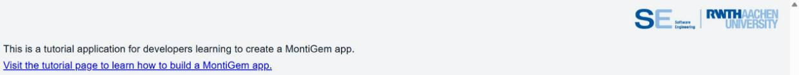

# Prerequisites

!!! abstract "In this chapter"
    - install Java and set up access to the MontiGem artifacts
    - get the example project
    - build the app, start backend and frontend, and open it in the browser
    - learn which command you need after which kind of change

## Installation

### Install Java 21

=== "Windows"

    - Download and install [Java 21](https://www.oracle.com/java/technologies/downloads/#jdk21-windows)
      and extract the folder. Older builds are in the
      [Java archive](https://www.oracle.com/java/technologies/downloads/archive/).
    - The extracted folder contains `jdk-21`. You can copy it into
      `Program Files/Java`, the standard path for JDKs.
    - Add an environment variable `JAVA_HOME` with the `jdk-21` directory as its
      value, e.g. `C:\Program Files\Java\jdk-21`.
    - Add the entry `%JAVA_HOME%\bin` to the `Path` environment variable.

=== "Linux"

    - Install a JDK 21 with your package manager:

        ```sh
        sudo apt install openjdk-21-jdk          # Debian, Ubuntu
        sudo dnf install java-21-openjdk-devel   # Fedora
        ```

    - Set `JAVA_HOME` in your `~/.bashrc`. The path depends on the
      distribution, e.g. on Ubuntu:

        ```sh
        export JAVA_HOME=/usr/lib/jvm/java-21-openjdk-amd64
        ```

=== "macOS"

    - Install a JDK 21 with [Homebrew](https://brew.sh/) and register it with
      the system:

        ```sh
        brew install openjdk@21
        sudo ln -sfn $(brew --prefix)/opt/openjdk@21/libexec/openjdk.jdk /Library/Java/JavaVirtualMachines/openjdk-21.jdk
        ```

    - Set `JAVA_HOME` in your `~/.zshrc`:

        ```sh
        export JAVA_HOME=$(/usr/libexec/java_home -v 21)
        ```

Open a new console and run `java -version` to check that Java works.

!!! tip
    On Linux and macOS, [SDKMAN!](https://sdkman.io/) is an alternative: it
    installs a JDK and sets `JAVA_HOME` for you. `sdk list java` shows the
    available versions.

### Set up access to the MontiGem artifacts

The MontiGem generator and its runtime are published in the Nexus repository of
the Software Engineering chair. You need an account there. If you do not have
one, ask the MontiGem team at SE RWTH Aachen for access.

Create a `gradle.properties` file in the `%userprofile%/.gradle` folder
(`~/.gradle` on Linux and macOS) with this content:

```properties title="%userprofile%/.gradle/gradle.properties"
mavenUser=my_user
mavenPassword=my_password
```

Replace `my_user` and `my_password` with your Nexus account name and password.
Without this file the build fails with an authentication error while resolving
dependencies.

### (Optional) Install a plugin for language support

The plugins add syntax highlighting and code completion for the modeling languages. 

**Downloads**

  - [IntelliJ](https://git.rwth-aachen.de/monticore/umlp/-/jobs/artifacts/dev/raw/umlp-tool/umlp-intellij-plugin/build/distributions/umlp-intellij-plugin.zip?job=build_intellij_plugin)
  - [Visual Studio Code](https://git.rwth-aachen.de/monticore/umlp/-/jobs/artifacts/dev/raw/umlp-tool/build/generated-sources/UMLPWithGUI/plugins/umlpwithgui-vscode-plugin/umlpwithgui-lsp.vsix?job=build_with_deploy)

**Plugin installation guides**

  - IntelliJ: [https://www.jetbrains.com/help/idea/managing-plugins.html#install_plugin_from_disk](https://www.jetbrains.com/help/idea/managing-plugins.html#install_plugin_from_disk)
  - VSCode: [https://code.visualstudio.com/docs/configure/extensions/extension-marketplace#_install-from-a-vsix](https://code.visualstudio.com/docs/configure/extensions/extension-marketplace#_install-from-a-vsix)

## Getting the project

Download the training version of the example project:
[montigem3-training.zip](https://git.rwth-aachen.de/monticore/umlp-anwendungen/montigem3-tutorial/-/jobs/artifacts/dev/raw/build/montigem3-training.zip?job=pack_training). Unpack it anywhere.

In the training version, every place where you add code is marked with a
`// TODO:` comment that names the chapter, for example:

```java title="models/Carrental.umlp"
  // TODO: 01 Class Diagram Basics - enum RentableStatus
```

!!! tip "Alternative for Windows: the launcher"
    The experimental launcher installs the same training version and sets up
    Java and Gradle for you.
    [Download the launcher](https://nexus.se.rwth-aachen.de/service/rest/v1/search/assets/download?repository=monticore-snapshots&group=de.se_rwth.montiinit&name=guiLauncher&maven.classifier=native&maven.extension=exe&sort=version),
    start it and choose the project type `montigem_tutorial`.

## Commands

Run all commands in a console in the project folder. In the Windows command
prompt (`cmd`) write `gradlew` instead of `./gradlew`.

### Build

To build the project, use the following command:

```sh
./gradlew build
```

!!! note
    The first build takes 10 to 20 minutes and has long phases without any
    output. `npm warn` messages are normal.

### Run

Backend and frontend run as two separate processes. Neither of them stops on its
own, so use two console windows.

Open a console and start the backend:

```sh
./gradlew :backend:run
```

The backend is ready when the log ends with these two lines:

```
[restartedMain] INFO org.springframework.boot.web.embedded.tomcat.TomcatWebServer - Tomcat started on port 8081 (http) with context path '/umlp/api'
[restartedMain] INFO carrental.CarrentalServerApplication - Started CarrentalServerApplication in 3.2 seconds (process running for 3.6)
```

!!! note
    Yellow `[WARN]` lines before them, such as `I AM ALIVE!`, are normal
    start-up output.

Open another console and start the frontend:

```sh
./gradlew :frontend:run
```

The frontend is ready when the last lines are:

```
Application bundle generation complete.
Watch mode enabled. Watching for file changes...
    Local:   http://localhost:4200/
```

!!! note
    Yellow `Deprecation [plugin angular-sass]` warnings are harmless.

Open the browser and navigate to [localhost:4200](http://localhost:4200) to see
the app. The app shows a text directing you to the start of the tutorial:



### Stop

Stop the backend or the frontend by pressing `ctrl+c` in its console.

!!! warning
    The next instruction kills the process that uses port 4200. This is the node
    process running the frontend app. If you have a special setup that uses port
    4200 for something else you will need to adjust the scripts.

The frontend dev server sometimes survives `ctrl+c`, because Gradle starts it as
a separate process. Run the `killfe` script in the project folder in a console
with administrative rights:

```
killfe
```

On Windows you can also use `killfe.ps1` in a PowerShell. For a Unix-like
environment use:

```sh
sudo ./killfe.sh
```

!!! note
    `killfe` stands for kill frontend. The script finds the process which uses
    port 4200 and kills it if such a process is found. This is a crutch of the
    `gradle` build system and OS process management. The behavior may vary and
    you might not need to kill the process manually, it might terminate on its
    own later.

## Which command after which change

While backend and frontend are running, you do not rebuild everything. Use this
table. Every chapter repeats the command you need at that point.

| You changed | Run this |
|---|---|
| A GUI model (`*.gui`), frontend Java, SCSS or a new hand-written TypeScript file | `./gradlew :frontend:generate` |
| The class diagram `models/Carrental.umlp` | restart the backend, then `./gradlew :frontend:generate` |
| A new file in `models/ocl/` | `./gradlew :backend:umlp2java --rerun-tasks`, restart the backend, then `./gradlew :frontend:generate` |
| Backend Java code only | restart the backend |
| An existing hand-written TypeScript file in `frontend/src/main/gui` | nothing, the dev server picks it up |

Run `./gradlew :frontend:generate` in a third console while `./gradlew :frontend:run`
keeps running.

When the dev server has picked up the change, the console that runs
`./gradlew :frontend:run` prints:

```
Application bundle generation complete.
Page reload sent to client(s).
```

!!! tip "Let Gradle watch your files"
    Instead of running `generate` after every change, you can start
    `./gradlew :frontend:continuous --continuous` in the third console. Gradle
    then waits for changes and runs `generate` whenever you save one of its
    inputs: a GUI model, frontend code or the class diagram. Stop it with
    `ctrl+c`. After a change of the class diagram you still restart the backend
    yourself.

### Try it

Open `frontend/src/main/gui/gui/Start.gui`. It shows a text and a link:

```ts title="frontend/src/main/gui/gui/Start.gui"
page Start() {
  @GemText(value = "This is a tutorial application for developers learning to create a MontiGem app.");
  @GemLink(
    url = "https://monticore.pages.rwth-aachen.de/umlp/Tutorial.html",
    text = "Visit the tutorial page to learn how to build a MontiGem app."
  );
}
```

Change the value of the `@GemText` to `"Hello, World!"` and run:

```sh
./gradlew :frontend:generate
```

The first run of this command takes a bit. When it is done, the browser reloads
and shows your text.

!!! note
    If your changes are invalid, e.g. the updated GUI model has errors, the
    console running `./gradlew :frontend:generate` displays the error and the page
    does not reload. Fix the error and run the command again.

## If something does not work

| Symptom | Cause and fix |
|---|---|
| The backend stops right after start, or the frontend cannot reach it (the log says `Port 8081 was already in use`) | Port 8081 is already in use, for example by another MontiGem app. Stop that app. If you cannot, start the backend on another port and tell the frontend about it: set `PORT=8082` before `:backend:run` and `BACKEND_PROXY_ADDRESS=http://localhost:8082/` before `:frontend:run`. In PowerShell that is `$env:PORT="8082"` and `$env:BACKEND_PROXY_ADDRESS="http://localhost:8082/"`, each in the console of the process it belongs to. |
| `Port 4200 is already in use` | An old dev server is still running. Use `killfe`. |
| `[vite] ws proxy error: ECONNREFUSED` in the frontend console | The backend is not running (yet). Start it, and the message disappears. |
| `TS2307: Cannot find module 'carrental/...'` after a model change | The frontend has the new GUI code but not the new domain code. Run `./gradlew :frontend:generate`. |
| The console of `generate` prints `Failed to open non-existing directory: ...\cd2java` or `...\ocl2java` | Normal. MontiGem creates these folders only when the project uses the matching generator, `ocl2java` for example from chapter 12 on. |
| Compile errors in files under `build/` | Those files are generated. The cause is in your model or in your hand-written code. Fix that and generate again. |
| A JSweet error mentioning `getLineMap()` | Your frontend Java code does not compile. Fix the Java error first. The JSweet message is only a consequence of it. |
| Authentication error while downloading dependencies | Check `mavenUser` and `mavenPassword` in `%userprofile%/.gradle/gradle.properties`. |

## Checkpoint

- `./gradlew build` finishes with `BUILD SUCCESSFUL`.
- The backend log ends with `Started CarrentalServerApplication in ... seconds`.
- [localhost:4200](http://localhost:4200) shows the start page with the text and
  the link, as in the screenshot above.
- After changing the `@GemText` and running `./gradlew :frontend:generate`, the
  browser shows the new text.
