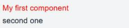
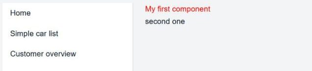
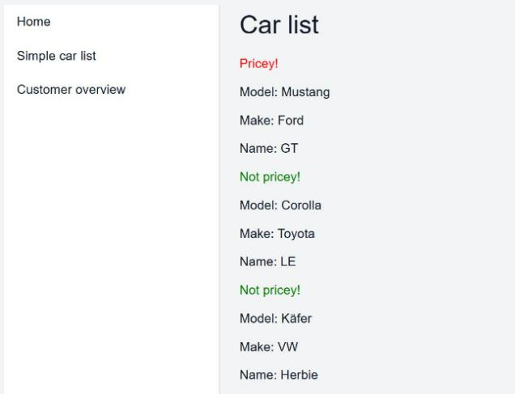

# GUI Basics

!!! abstract "In this chapter"
    - write your first GUI models
    - build a navigation bar and reuse it on other pages
    - load domain objects into a page and iterate over them
    - files you touch: `models/Carrental.umlp`,
      `frontend/src/main/gui/gui/Start.gui`,
      `frontend/src/main/gui/gui/navigation/NavContainer.gui`,
      `frontend/src/main/gui/gui/SimpleCarList.gui`,
      `backend/src/main/java/carrental/CarrentalServerApplication.java`

The source for the graphical user interface (GUI) of MontiGem apps are GUI DSL
(domain-specific language for GUIs) models. The most basic concepts include:

- the GUI component (or simply component),
- control statements.

!!! note
    A complete list will be discussed later, you may also take a look at the
    [GUI DSL project](https://git.rwth-aachen.de/monticore/languages/gui-dsl)
    (only available via GitLab invite).

## GUI component

Each web page or reusable part of a page is described using a GUI model. The
rough structure of a component is:

```java
package mypackage.name;

import external.Component;
import some.external.Classdiagram.TypeName;
import maybe.java.TypeName2;

component ComponentName(TypeName paramName, TypeName2 paramName2) {
  /* component usages, control statements, etc. */
}
```

It contains

- a single package declaration,
- an optional list of imports,
- a single component declaration with the keyword `component` or `page`. A
  `page` is a `component` that has its own URL address and can be navigated to,
- optional contents of the component, e.g. component usages and control
  statements.

!!! note
    Since a `page` is a `component` it can also be used as a component, see the
    component usages further below.

!!! note
    Optional contents mean that you can omit the curly braces and everything in
    between. This is used for more advanced cases which will be discussed later.

!!! info
    You will often see the terms *component declaration* and *component usage*:

    - A *declaration* means that you create a template for a specific component.
      It is similar to declaring a class in Java.
    - A *usage* means that you create an instance of a specific component. It is
      similar to class instantiation (calling a constructor) in Java.

The car rental example already contains the `Start.gui` model:

```ts title="frontend/src/main/gui/gui/Start.gui"
package gui;

import mc.fenix.basic.GemText;
import mc.fenix.basic.GemLink;

page Start() {
  @GemText(value = "This is a tutorial application for developers learning to create a MontiGem app.");
  @GemLink(
    url = "https://monticore.pages.rwth-aachen.de/umlp/Tutorial.html",
    text = "Visit the tutorial page to learn how to build a MontiGem app."
  );
}
```

### What the generator makes of it

!!! note
    The following information about generated files is useful for understanding
    the app and when you want to override the default behavior.

A GUI model defines an Angular component. The generator writes its files to
`frontend/build/gui2java`. JSweet then translates the Java files to TypeScript
in `frontend/build/gui2java2ts`, and `generate` copies the result to
`frontend/build/app/gui2java2ts`, where the Angular build picks it up. The
following structures are generated from a component declaration:

* Java file: `Start.java` with the main component logic, such as loading and
  sending data, subscribing to changes in the data, and data conversions for
  presentation in the GUI. JSweet translates it to `Start.ts`.
* TypeScript file: `StartComponent.ts` that connects Angular-specific features
  with the logic from `Start.java`. The Angular component class in this file
  extends the class translated from `Start.java`.
    * The file also includes a `config` constant that specifies the default
      Angular-specific configuration for the component.
* HTML template of the component: `Start.html` whose contents are defined by the
  contents of the component: component usages, control statements, etc. If there
  are no contents, the file is empty.
* Although not directly generated from models, each `page` contributes to the
  routing information file. `page Start` is in `package gui` which results in a
  `GuiGemRouting.ts` file specifying that the URL path `gui/Start` navigates to
  `page Start`.

## GUI component contents

A GUI component without contents doesn't show anything. To create a proper web
page with contents you should import and use other components. This is the basic
idea of any web framework for building GUIs: define some basic components, use
them in other components to build new components, and repeat until you have an
entire page.

The rough structure of a component usage is:

```ts
instanceName@ComponentName(paramName1 = arg1, paramName2 = arg2);
```

It contains:

- an optional instance name (a variable holding the component instance),
- an `@` sign followed by the component name,
- a list of arguments, where parameter assignment is done via the parameter name.

!!! note
    This is similar to parameter assignment in Python or R. Assignment by order
    (e.g. `@ComponentName(arg1, arg2)`) is not allowed.

Try it yourself. Replace the two component usages in the `Start` page of the car
rental example:

```ts title="frontend/src/main/gui/gui/Start.gui"
package gui;

import mc.fenix.basic.GemText;

page Start() {
  @GemText(color = "red", value = "My first component");
  @GemText(value = "second one");
}
```

Apply the change with:

```sh
./gradlew :frontend:generate
```

The result is a web page with text:



`GemText` is a library component. The library components can be found in the
[documentation for library components](../gendoc_components/Frontend-RTE.md).

### A navigation bar

Showing text is a good start but it is not enough. In practice one of the first
steps is to create a navigation bar. Create the directory
`frontend/src/main/gui/gui/navigation` and in it a new file `NavContainer.gui`
with the following content:

```ts title="frontend/src/main/gui/gui/navigation/NavContainer.gui"
package gui.navigation;

import mc.fenix.arrange.GemRow;
import mc.fenix.arrange.GemColumn;

import mc.fenix.navigation.GemNavItem;
import mc.fenix.navigation.GemNavList;

component NavContainer(List<GUIViewElement> content) {
  // row of components, from left to right: navigation bar, main content.
  @GemRow(colGap = "25px", components = [
    // navigation bar
    @GemNavList(width = "40ch", height = "100vh", components = [
      @GemNavItem(title = "Home", target = "/gui/Start"),
      @GemNavItem(title = "Simple car list", target = "/gui/SimpleCarList"),
      @GemNavItem(title = "Customer overview", target = "/gui/CustomerOverview")
    ]),
    // main content
    @GemColumn(hAlign = "center", components = content)
  ]);
}
```

`NavContainer` defines a template for a web page that has a navigation bar. It
consists of other library components and declares a list of `GUIViewElement`
objects as a parameter named `content`. The type `GUIViewElement` represents any
GUI component. Here the list of components is passed to the `GemRow` component
that renders the passed content from left to right. The definition of the
`components` parameter of `GemRow` is similar to `content`:

```ts
package mc.fenix.arrange;

component GemRow(
  List<GUIViewElement> components /*, other parameters */
)
```

`GemNavList` and `GemNavItem` are library components for building a navigation
bar. `GemNavList` is a layout container. `GemNavItem` is a button that redirects
a user to a part of the application via the URL specified by the `target`
argument. A URL is constructed from the fully qualified name of a page, compare:

```
gui.Start
gui.SimpleCarList
gui.CustomerOverview
```

and

```
/gui/Start
/gui/SimpleCarList
/gui/CustomerOverview
```

Whenever you add a page, you can add a corresponding navigation item (or a
`GemLink`) to enable navigation to the new page. You will add three more items
in the following chapters. More advanced cases will be discussed later.

!!! note
    `/gui/SimpleCarList` does not currently navigate to any existing page. We
    will add one later in this chapter.

Let's adjust the `Start` page and use `NavContainer`. We pass a list with the
previously created `GemText` components to the `content` parameter:

```ts title="frontend/src/main/gui/gui/Start.gui"
package gui;

import mc.fenix.basic.GemText;

import gui.navigation.NavContainer;

page Start() {
  @NavContainer(content = [
    @GemText(color = "red", value = "My first component"),
    @GemText(value = "second one")
  ]);
}
```

Run `./gradlew :frontend:generate` again. The result is a web page with a
navigation bar and text:



### Types of component parameters

`NavContainer` demonstrated the usage of the type `GUIViewElement`. There are
several notable types that are used as GUI component parameter types:

* A subset of [commonly used Java types](https://docs.oracle.com/javase/tutorial/java/nutsandbolts/datatypes.html)

    * `int`, `Integer`
    * `long`, `Long`
    * `float`, `Float`
    * `double`, `Double`
    * `void`, `Void`
    * `String`
    * `List<T>`
    * `Object`

* Types describing concepts of user interfaces

    * `Event<T>`
    * `GUIViewElement`

* Types imported from Java or from class diagrams

The arguments you supply to the components must be compatible with the parameter
type. We omit some types for now and only use the most common ones:

* The commonly used types are self-explanatory, for example, the `value`
  parameter of `GemText` is a `String`:

  ```ts
  component GemText(String value /*, other params */)
  ```

* A `List` of objects is created using square brackets (an OCL-like syntax).
  From the example earlier:

  ```ts
  @NavContainer(content = [
    @GemText(color = "red", value = "My first component"),
    @GemText(value = "second one")
  ]);
  ```

  Depending on the type, the content is different, e.g. a `List<Integer>`:
  `[1, 2, 3]`.

* You can import types from class diagrams. Here we discuss only the ones
  imported from a domain class diagram (the one that defines the data structure
  of the app). We will call those "domain types". Domain types are handled
  separately by MontiGem, since for objects of these types MontiGem generates
  multiple features, such as automatic updates of the objects in the GUI across
  different app users, saving the objects in the database, caching, etc.

## A page that shows domain objects

We would like to have a page showing the list of cars. First add the class `Car`
to the domain class diagram:

```java title="models/Carrental.umlp"
class Car {
  String make;
  String model;
  String name;
}
```

Then create some cars in the `initEntities()` method. Use the makes `Ford`,
`Toyota` or `VW`, because the project ships pictures only for those:

```java title="backend/src/main/java/carrental/CarrentalServerApplication.java"
Car ford = CarrentalManager.carBuilder()
    .make("Ford")
    .model("Mustang")
    .name("GT")
    .build()
    .get();

Car toyota = CarrentalManager.carBuilder()
    .make("Toyota")
    .model("Corolla")
    .name("LE")
    .build()
    .get();

Car vw = CarrentalManager.carBuilder()
    .make("VW")
    .model("Käfer")
    .name("Herbie")
    .build()
    .get();
```

Now create the GUI model for the page:

```ts title="frontend/src/main/gui/gui/SimpleCarList.gui"
package gui;

// data class
import Carrental.Car;

page SimpleCarList(List<Car> cars) {
  /* ... */
}
```

Here we import the `Car` class from the domain class diagram. Whenever an input
parameter of a type from a class diagram is used, MontiGem generates logic to
automatically load the object if possible. Specifically here we use `List<Car>`
which loads all objects of type `Car`.

!!! note
    There is also logic for loading a single `Car` which will be discussed
    [later](./07_GUIAdvanced2.md).

!!! info
    The types are imported using the so-called *fully qualified names*. The
    fully qualified name concept is
    [general for programming languages](https://en.wikipedia.org/wiki/Fully_qualified_name):
    it is a name that uniquely identifies a type, method or variable, which is
    used by a compiler (interpreter, generator) to identify an entity.

    In Java and the GUI DSL a fully qualified name of a type or component
    consists of the package name (if present) and the type or component name
    respectively, e.g. `java.util.List`, `gui.navigation.NavContainer`. In CD4A
    (the class diagram language) the fully qualified name of a type consists of
    the package name (if present), the class diagram name, and the type name,
    e.g. `somepackage.Carrental.Car`.

## Control statements

Now that we want to display a list of cars, we need to be able to go over the
list and show the details. Update the `SimpleCarList` page:

```ts title="frontend/src/main/gui/gui/SimpleCarList.gui"
package gui;

import mc.fenix.basic.GemText;
import mc.fenix.arrange.GemColumn;

import gui.navigation.NavContainer;

// data class
import Carrental.Car;

page SimpleCarList(List<Car> cars) {
  @NavContainer(content = [
    @GemColumn(rowGap = "10px", components = [

      @GemText(value = "Car list", size = "2rem"),
      // iterate (loop) through cars and show their info
      @iterate(Car c : cars) {
        // if it's Ford then show that it costs more
        @guard(c.make.equals("Ford")) {
          @GemText(value = "Pricey!", color = "red");
        }
        else {
          @GemText(value = "Not pricey!", color = "green");
        }
        @GemText(value = "Model: " + c.model);
        @GemText(value = "Make: " + c.make);
        @GemText(value = "Name: " + c.name);
      }

    ])
  ]);
}
```

!!! warning "Separators inside a component list"
    Inside `components = [ ... ]` the entries are separated by commas. Inside
    the block of an `@iterate` or `@guard` every component usage ends with a
    semicolon, as in the example above. Mixing this up is the most common syntax
    error in GUI models.

Besides the usual components we have the `iterate` and `guard..else` constructs.

- `iterate` is similar to a `for` loop: you can go through a list of elements and
  create an instance of a component for each element.
- `guard..else` is similar to `if..else`: you can specify whether one or several
  components should be shown depending on a condition. The `else` block is
  optional.

You changed the class diagram, so restart the backend and update the frontend:

```sh
./gradlew :frontend:generate
```

Depending on your dummy data, the simple car list page looks like this:



!!! question "Why are they called `iterate` and `guard` instead of `for` and `if`?"
    Those constructs work a bit differently. Unlike in a normal program, these
    are evaluated "continuously", i.e. whenever some source of data changes,
    e.g. new cars are added or the name of a car gets changed, the changes are
    propagated at application runtime as soon as possible and are reflected in
    the GUI. This also applies to the components.

## Checkpoint

- [http://localhost:4200/gui/Start](http://localhost:4200/gui/Start) shows the
  navigation bar on the left and the two texts.
- [http://localhost:4200/gui/SimpleCarList](http://localhost:4200/gui/SimpleCarList)
  lists three cars. The Ford is marked "Pricey!", the other two "Not pricey!".
- The navigation items switch between the pages.
