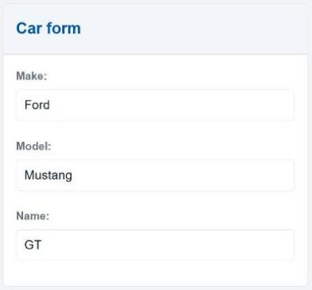

# Updating objects

Let's build a simple form for updating cars' model and name by creating the following new page:
```java
package gui;

import gui.navigation.NavContainer;

import Carrental.Car;
import mc.fenix.input.GemTextInput;
import mc.fenix.arrange.GemCard;
import mc.fenix.arrange.GemColumn;

page CarUpdate(Car car) {
  @NavContainer(content = [
    @GemCard(title = "Card form", component =

      @GemColumn(width = "40ch", rowGap = "5px", components = [
        @GemTextInput(
          labelText = "Model:",
          entry = car.model
        ),
        @GemTextInput(
          labelText = "Name:",
          entry = car.name
        )
      ])

    )
  ]);
}
```
The notable difference to the overview page is that we have a single `car` as an
input instead of a list. When the generator sees a single domain object, it
assumes that this object is somewhere in the database and will generate code for
loading the object.

The result:


The form uses `GemTextInput` component to connect attributes of `car` with an
input field. The `entry` parameter of `GemTextInput` has type `?String`, which
unlike normal `String` indicates extended functionality: 
- the value of `entry` is updated when the attribute of `car` is updated (same
  as for normal `String` parameter). For example, if `car.model` is changed, the
  value of input field gets updated.
- the value of the attribute of `car` is updated when an app user enters a new
  value into the input field. For example, if a user enters `Fiesta` into the
  field, the `car.model` value becomes `Fiesta`.

## Navigation

We have a page, but we need to navigate to it somehow.
To do so we need to:

1. Choose a page to navigate from
2. Import the page to navigate to
3. Use the predefined `navigate` function

The page always shows a *specific* car, so the generator creates a URL that
is specific to a car: `gui/CarUpdate/:carRoutingId`, where `carRoutingId` is
a unique identifier for the car. The car object has to be specified when navigating to the
page.

!!! note 
    The URL is composed of the fully qualified name of the component and input
    parameter ids, compare `gui.CarUpdate` with `car` parameter has the URL
    `gui/CarUpdate/:carRoutingId`

Previously defined `overview` page has access to all the cars, so we add a
navigation button for every car:
```java
package gui;

import mc.fenix.basic.GemButton;
import gui.CarUpdate;
/* imports */
page CarOverview(List<Car> cars) {
  /*...*/
  @iterate(Car c : cars) {
    /*...*/
    @GemButton(leftClick = navigate(@CarUpdate(car = c)));
  }
}
```

!!! note
    Navigate is a predefined function that does not need to be implemented in handwritten code.

## Creating objects

We also want to be able to create a new `car`. The `CarUpdate` page basically
has all we need, except we don't want to show an existing object, but create a new
one. Our goals:

1. extract a form from `CarUpdate` that can be used for car creation page
2. use extracted form to build creation page

The whole content of the `CarUpdate` can be reused for creation page:
```java
package gui;
/*...*/
component CarForm(Car car) {
  @NavContainer(content = [
    @GemCard(title = "Card form", component =

      @GemColumn(width = "40ch", rowGap = "5px", components = [
        @GemTextInput(
          labelText = "Model:",
          entry = car.model
        ),
        @GemTextInput(
          labelText = "Name:",
          entry = car.name
        )
      ])

    )
  ]);
}
```

Resulting `CarUpdate` page:
```java
package gui;
/*...*/
page CarUpdate(Car car) {
  @CarForm(car = car);
}
```

The creation page should then look the same:
```java
package gui;
/*...*/
page CarCreate(Car car) {
  @CarForm(car = car);
}
```

For the generator to recognize that the `car` object doesn't exist yet we
have to specify it in the `frontend/build.gradle` configuration that the
model is used for object creation:
```groovy
gui2java {
  guiCreateModels = ["gui.CarCreate"]
}
```
The `guiCreateModels` is a list of fully qualified names of models that are
used for creation of objects.

!!! note
    Future versions will remove that requirement

The `CarCreate` page now uses a new `car` object instead of existing one and
doesn't require an id to navigate to, its URL is `gui/CarCreate`.

Just putting values into input fields will not save the object though, we need
to explicitly trigger object creation. For this we add a button to the `CarForm` page,
injected from the `CarCreate` page:
```java
component CarForm(Car car, GUIViewElement button) {
  @NavContainer(content = [
    @GemCard(title = "Card form", component =
      @GemColumn(width = "40ch", rowGap = "5px", components = [
        @GemTextInput(
          labelText = "Model:",
          entry = car.model
        ),
        @GemTextInput(
          labelText = "Name:",
          entry = car.name
        ),
        button
      ])
    )
  ]);
}
```
```java
page CarCreate(Car car) {
  @CarForm(car = car,
    button = @GemButton(label = "Create", leftClick = createAndNavigate(car))
  );
}
```
We don't want to directly add a button to the `CarForm`, since the `CarUpdate`
page uses the same form, and a "create"-button wouldn't make sense for that
page.

The button should save the object and navigate to the overview page. 
Thus, we add the following method to the `CarCreate` Java class (which you need to create, in the same folder as `CarOverview.java`):
```java
package gui;

import carrental.Car;
import carrental.CarrentalManager;
import app.AppRouter;
import umlp.jsweet.extension.annotation.Component;

import java.util.function.Consumer;

@Component()
public class CarCreate extends CarCreateTOP {
  @Override
  public Consumer<Void> createAndNavigate(Car car) {
    return $ -> {
      CarrentalManager.carBuilder()
        .make(car.getMake())
        .model(car.getModel())
        .name(car.getName())
        .build();
      AppRouter.navigateToGuiCarOverview();
    };
  }
}
```
To save the object, we simply need to call the `build` method of the object.

To be able to access Routing functionality of a webpage from handwritten code,
there is the generated class `app.AppRouter` which contains static navigation methods
for every page.

<!--
Unfortunately, this method will not work, because the object has to be valid
before it is saved. The class diagram defines `RentableItem` class like so (simplified):
```java
class RentableItem {
  float costPerDay;
  float mileage;
  RentableStatus rentableStatus;
}

class Car extends RentableItem {
  /* ... */
}

association [1] Car -> MileageDataPoint [*];
```

All attributes of `Car` need to be not `null` and since it extends `RentableItem`, this means all attributes of both
classes have to be filled.

!!! note
    The class `MileageDataPoint` does not exist yet, create it with attributes for record date and mileage.

None of the listed attributes are optional, which means all of them must be set
to some value. Since `MileageDataPoint` has `*` cardinality, there may be `0`
objects in the association, which makes it optional.
-->
