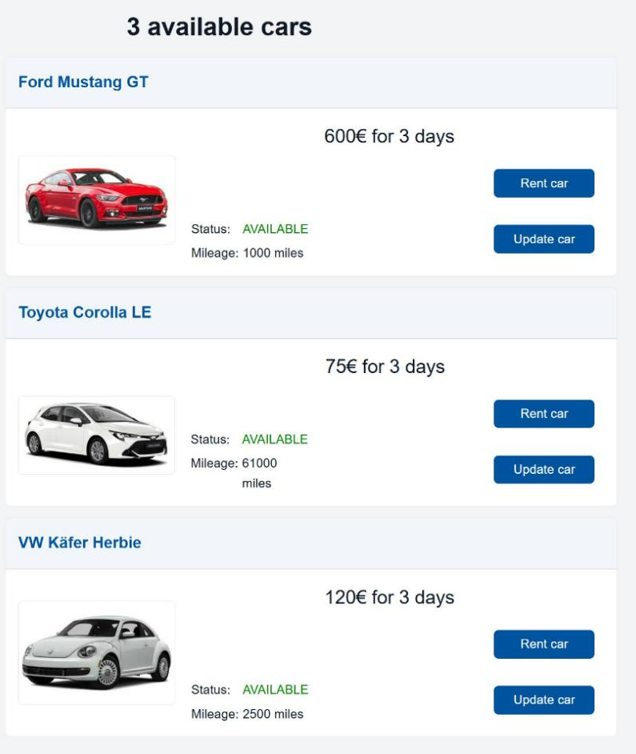
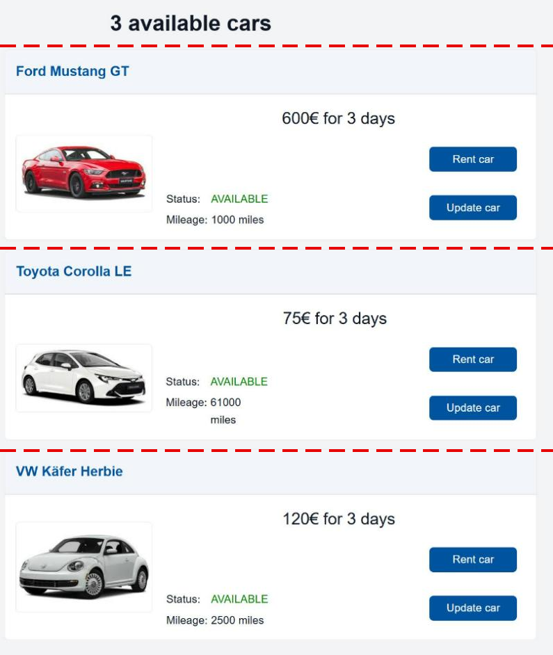
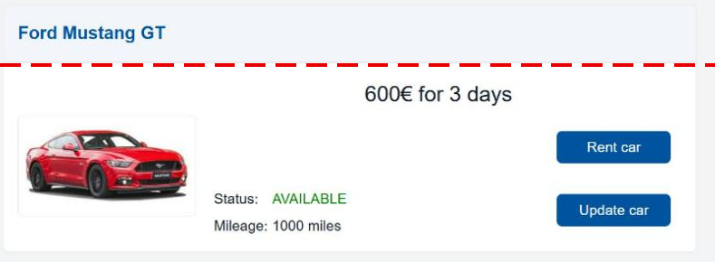
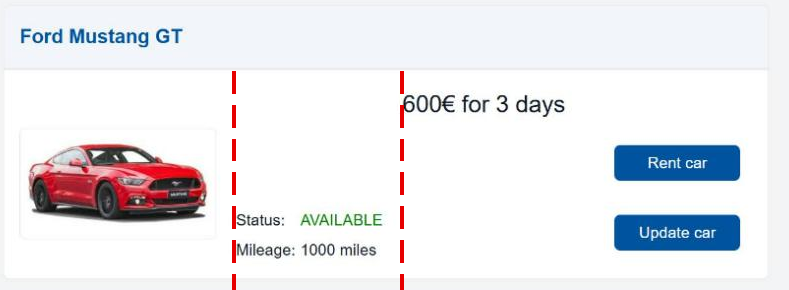
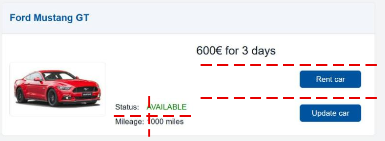
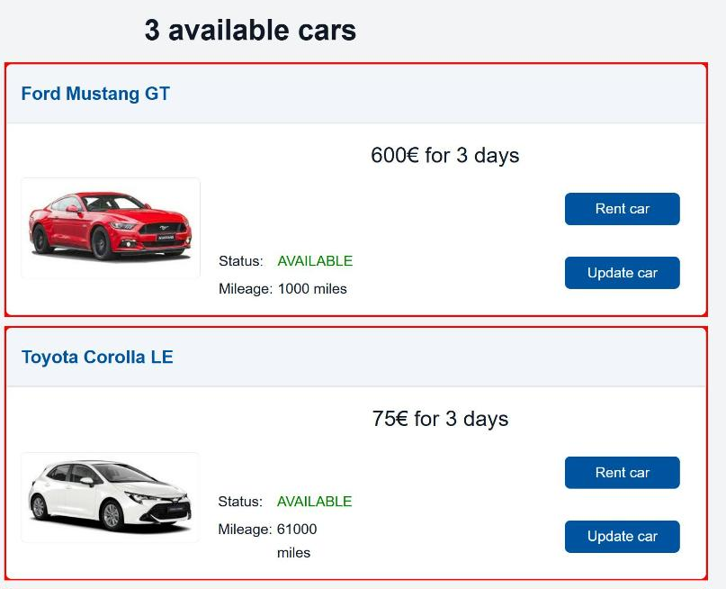
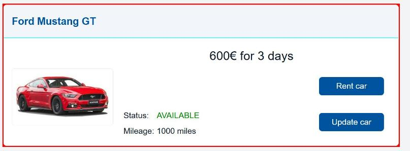

# GUI Layout

!!! abstract "In this chapter"
    - arrange components with rows, columns, grids and cards
    - learn a repeatable process for building a layout
    - style a component with your own SCSS
    - files you touch: `models/Carrental.umlp`,
      `backend/src/main/java/carrental/CarrentalServerApplication.java`,
      `frontend/src/main/gui/gui/CarOverview.gui`,
      `frontend/src/main/gui/gui/CarForm.gui`,
      `frontend/src/main/java/gui/CarCreate.java`,
      `frontend/src/main/gui/gui/CarOverview.scss`

A typical layout of a component consists of a combination of columns, rows and
grids. The `mc.fenix.arrange` package contains the corresponding components
`GemColumn`, `GemRow`, and `GemGrid`.

!!! note
    These components are based on the
    [flexbox layout](https://developer.mozilla.org/en-US/docs/Web/CSS/Guides/Flexible_box_layout/Basic_concepts)
    and the
    [grid layout](https://developer.mozilla.org/en-US/docs/Web/CSS/Guides/Grid_layout/Basic_concepts).

## More data to show

To make the process more realistic, let's add some data to a car:

```java title="models/Carrental.umlp"
class Car {
  String make;
  String model;
  String name;
  RentableStatus rentableStatus = RentableStatus.AVAILABLE;
  float costPerDay = 100.0f;
  float mileage = 0.0f;
}
```

!!! warning "Float literals"
    Write `0.0f`, not `0`. The generator copies the literal into the generated
    Java code, where an `int` literal does not fit into a `Float` attribute and
    the backend fails to compile.

Set the new attributes in the dummy data as well:

```java title="backend/src/main/java/carrental/CarrentalServerApplication.java"
Car ford = CarrentalManager.carBuilder()
    .make("Ford")
    .model("Mustang")
    .name("GT")
    .costPerDay(200.0f)
    .mileage(1000.0f)
    .build()
    .get();

Car toyota = CarrentalManager.carBuilder()
    .make("Toyota")
    .model("Corolla")
    .name("LE")
    .costPerDay(25.0f)
    .mileage(61000.0f)
    .build()
    .get();

Car vw = CarrentalManager.carBuilder()
    .make("VW")
    .model("Käfer")
    .name("Herbie")
    .costPerDay(40.0f)
    .mileage(2500.0f)
    .build()
    .get();
```

Both new attributes have a default value, so the creation form from the
[previous chapter](./07_GUIAdvanced2.md) keeps working. Still, a user should be
able to set the price. Add a field to `CarForm` and extend the builder:

```ts title="frontend/src/main/gui/gui/CarForm.gui"
@GemTextInput(
  labelText = "Cost per day:",
  inputType = "number",
  entry = car.costPerDay
),
```

```java title="frontend/src/main/java/gui/CarCreate.java"
import carrental.RentableStatus;
/* other imports */

CarrentalManager.carBuilder()
    .make(car.getMake())
    .model(car.getModel())
    .name(car.getName())
    .costPerDay(car.getCostPerDay())
    .mileage(0.0f)
    .rentableStatus(RentableStatus.AVAILABLE)
    .build();
```

You changed the class diagram, so restart the backend and update the frontend:

```sh
./gradlew :frontend:generate
```

## The extended overview page

The `CarOverview` so far had a simple layout. Now we update it to an extended
layout configuration:

```ts title="frontend/src/main/gui/gui/CarOverview.gui"
package gui;

import mc.fenix.basic.GemText;
import mc.fenix.basic.GemImage;
import mc.fenix.basic.GemButton;
import mc.fenix.arrange.GemColumn;
import mc.fenix.arrange.GemRow;
import mc.fenix.arrange.GemGrid;
import mc.fenix.arrange.GemCard;

import gui.navigation.NavContainer;
import gui.CarUpdate;

import Carrental.Car;

page CarOverview(List<Car> cars) {
  @NavContainer(content = [
    @GemColumn(rowGap = "10px", width = "50%", hAlign = "center", components = [

      @GemText(value = getAvailableCarsTitle(cars), size = "2rem", weight = "bold"),
      @iterate(Car c : cars) {
        carInfo@GemCard(
          title = c.make + " " + c.model + " " + c.name,
          component = @GemRow(colGap = "20px", vAlign = "bottom", hAlign = "space-between",
            components = [
              @GemImage(width = "200px", source = "assets/images/" + c.make + ".jpg"),
              @GemGrid(width = "auto", colGap = "5px", rowGap = "5px", rows = [
                [
                  @GemText(value = "Status:"),
                  @GemText(
                    value = c.rentableStatus,
                    color = c.rentableStatus == RentableStatus.AVAILABLE ? "green" : "red"
                  )
                ],
                [
                  @GemText(value = "Mileage:"),
                  @GemText(value = c.mileage + " miles")
                ]
              ]),
              @GemColumn(width = "40ch", rowGap = "10px", hAlign = "right", components = [
                @GemText(value = (c.costPerDay * 3) + "€ for 3 days", size = "1.5rem"),
                @GemButton(label = "Rent car", leftClick = rentCar(c)),
                @GemButton(
                  label = "Update car",
                  leftClick = navigate(@CarUpdate(car = c))
                )
              ])
            ]
          )
        );
      }

    ])
  ]);
}
```

The result:



!!! note
    The default root for images, set in the `source` parameter of `GemImage`, is
    `frontend/config/src/`. The project ships pictures for the makes `Ford`,
    `Toyota` and `VW` in `frontend/config/src/assets/images/`. A car with a
    different make shows a broken image.

## The styling process

The styling process is normally iterative with the following steps:

1. Draw (or imagine) a sketch of the component with all of the parts laid out.
2. Split the components with horizontal and vertical lines.
3. Draft the layout in the model according to the lines:

    - components between horizontal lines are put into a `GemColumn`,
    - components between vertical lines are put into a `GemRow`,
    - components that are arranged in a grid pattern are put into a `GemGrid`.

4. Repeat steps 2 and 3 if necessary.
5. Fine-tune the layout using the properties of `GemColumn`, `GemRow` and
   `GemGrid`.

!!! tip
    Besides the three main layout components, you may consider using other
    components, such as `GemCard`. You should also build your own layout
    components if you notice the same layout pattern.

The following sections apply this process to the overview page. Each iteration
performs step 2 (split) and step 3 (draft the layout).

### Iteration 1: the page

First split with horizontal lines:



The parts are stacked vertically, so we use a `GemColumn` as the outermost
container:

```ts
@GemColumn(components = [
  @GemText(value = getAvailableCarsTitle(cars), size = "2rem", weight = "bold"),
  @iterate(Car c : cars) {
    /* image, text, buttons */
  }
])
```

The text component is in the right place, we have to arrange the content inside
`iterate`. Since the content for each car is arranged the same, we take the
first car as an example.

### Iteration 2: one car

At this point, we could split the content like this:



We could use a `GemColumn` again, but a better way is to use `GemCard`, which is
a fancier looking `GemColumn` suitable for grouping information:

```ts
@iterate(Car c : cars) {
  @GemCard(
    title = c.make + " " + c.model + " " + c.name
    /* image, text, buttons */
  )
}
```

### Iteration 3: the card content

Next split with vertical lines for the contents of the card:



The parts are next to each other, so we add a `GemRow`:

```ts
@GemCard(
  title = c.make + " " + c.model + " " + c.name,
  component = @GemRow(
    components = [
      @GemImage(width = "200px", source = "assets/images/" + c.make + ".jpg"),
      /* text */
      /* text and buttons */
    ]
  )
);
```

### Iteration 4: the last splits

The image is in place, the remaining parts split like this:



The status and mileage information is aligned in a grid pattern. The price and
the buttons are stacked vertically:

```ts
@GemRow(
  components = [
    @GemImage(width = "200px", source = "assets/images/" + c.make + ".jpg"),
    @GemGrid(rows = [
      [
        @GemText(value = "Status:"),
        @GemText(
          value = c.rentableStatus,
          color = c.rentableStatus == RentableStatus.AVAILABLE ? "green" : "red"
        )
      ],
      [
        @GemText(value = "Mileage:"),
        @GemText(value = c.mileage + " miles")
      ]
    ]),
    @GemColumn(components = [
      @GemText(value = (c.costPerDay * 3) + "€ for 3 days", size = "1.5rem"),
      @GemButton(label = "Rent car", leftClick = rentCar(c)),
      @GemButton(
        label = "Update car",
        leftClick = navigate(@CarUpdate(car = c))
      )
    ])
  ]
)
```

`GemGrid` allows you to define `rows`, `cols`, or for special cases `cells`. You
can get the same result using either of those, we use `rows` in this case,
because it is more intuitive to group a description of a characteristic and its
value into rows (otherwise you would have the columns `["Status:", "Mileage:"]`
and `["Available", "23 miles"]`).

!!! note
    You could do what a grid does with columns and rows, but it's more difficult
    to make sure that gaps and spaces are correctly aligned.

### Step 5: fine-tune the layout

For example, the column with the buttons:

- the column is 40 characters wide,
- there must be a 10 pixel gap between the buttons and the text,
- the column should be right aligned.

```ts
@GemColumn(width = "40ch", rowGap = "10px", hAlign = "right", components = [
  @GemText(/*...*/),
  @GemButton(/*...*/),
  @GemButton(/*...*/)
])
```

!!! note "Leave the width of buttons to the theme"
    The MontiGem theme gives every `GemButton` a minimum width of `8rem`. If you
    set a smaller `width`, the button is wider than the space you gave it and
    sticks out of the card.

## Styling

Further styling requires manual handling and slightly differs from case to case.
There is a similar process in all of the cases though:

* find the right style,
* define the found style in the right SCSS file.

One of the efficient ways of finding the right style is to use the
[browser inspector](https://developer.mozilla.org/en-US/docs/Learn_web_development/Howto/Tools_and_setup/What_are_browser_developer_tools)
and search for the element that needs to be modified.

You can either explore the HTML nodes of your page in the "Inspector" tab
directly or use a selection tool (marked on the image), example of the inspector
in Firefox:


Selected node:


In the inspector you can find a lot of information, including styles. Typically
you would want to modify a CSS class of the HTML node. In the given example we
want to add a red background for each card (we actually don't want that, it's
easy to see though). We can experiment with the styles directly in the inspector
by adding a style to an element or one of its classes (typically you should
prefer classes), here a class `carInfo` (the dot before the name means that it is
a CSS class):


The result: the red background shows as a red frame around each card, because
the title and the body of the card have their own background.



The first step of finding out what changes of CSS properties we need is done.
Next is to decide where to put the changes.

### Styling one component instance

If you want the changes to be specific to some component instance, you can
specify the id (name) of the component in the model, e.g.:

```ts
carInfo@GemCard(
  /*...*/
)
```

The `carInfo` id is also used as the name of a CSS class in the generated code.
After that you specify the style in the SCSS file of the component (see the
chapter about the [TOP mechanism](./03_TOPMechanism.md)). For the `carInfo`
components inside `CarOverview`, create the file
`frontend/src/main/gui/gui/CarOverview.scss`:

```scss title="frontend/src/main/gui/gui/CarOverview.scss"
.carInfo {
  min-width: 500px;
  background-color: red;
}
```

!!! warning "A new SCSS file needs one `generate`"
    The dev server does not pick up a newly created SCSS file on its own,
    because the generated Angular component has to reference it first. Run

    ```sh
    ./gradlew :frontend:generate
    ```

    once after creating the file. Later edits of the file are picked up
    automatically.

### Styling inside a library component

It gets a bit tricky if you need to change the style of an internal part of the
component. For example, if we want to change the color of the line separating
the card title and the card body, we would again find the right element:


But since the element is inside `GemCard`, which is a component that is outside
of the app, the normal modification rule will not work. Instead, we have to add
`:host ::ng-deep` before the rule:

```scss title="frontend/src/main/gui/gui/CarOverview.scss"
:host ::ng-deep .gem-card-line {
  background: aqua;
}
```



The additional `:host ::ng-deep` part of the style makes sure the style is
applied to the card line but only for the current page (`CarOverview`).

The styles you apply can target any elements and you can use
[different selectors](https://developer.mozilla.org/en-US/docs/Web/CSS/Guides/Selectors)
to specify what exact elements should be targeted. If, for example, an element
doesn't have a class, but is inside an element with a class, you can use this
information. For example, a different way to target the card line:

```scss
:host ::ng-deep .carInfo hr {
  background: aqua;
}
```

Here we select a child with the tag `hr` inside an element with the class
`.carInfo`.

### Global styles

If you want the changes to be global, e.g. change the line color for every card
on every page, put the style into the `styles.scss` file of your application
(create the file if it doesn't exist). The location is
`frontend/config/src/styles.scss`:

```scss title="frontend/config/src/styles.scss"
/* You can add global styles to this file, and also import other style files */
@import "../node_modules/@umlp/theme/src/main/gui/mc/fenix/theme/theme";

// make sure the default styles are included
@include montigem-theme();

// override one of the default styles
.gem-card-line {
  background: aqua;
}
```

MontiGem copies this file into the app. After creating or changing it, run

```sh
./gradlew :frontend:generate
```

### Conditional styling

To change the style of a component based on a condition (e.g. "selected" vs
"unselected"), you can use a `@guard` to switch between two instances with
different identifiers.

**Model:**

```ts
@guard(isSelected()) {
  selectedItem@GemButton(label = item.name);
} else {
  unselectedItem@GemButton(label = item.name);
}
```

**SCSS:**

```scss
.selectedItem .gem-button {
  background-color: blue;
}
.unselectedItem .gem-button {
  background-color: grey;
}
```

## Checkpoint

- The car overview shows one card per car with a picture, status, mileage, price
  and two buttons, like the screenshot above (your values differ, they come from
  your dummy data).
- "Update car" opens the update form, "Rent car" changes the status to `RENTED`
  and the color of the status text to red.
- After creating `CarOverview.scss` and running `generate` once, the cards
  have a red frame. Remove the `background-color` again when you have seen it.
