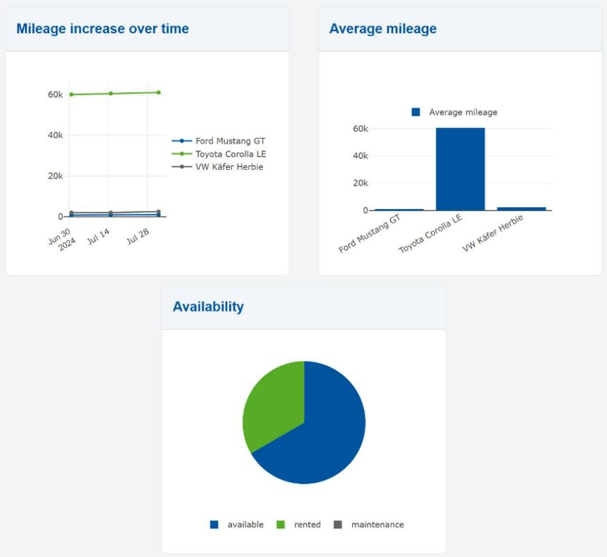

# Charts Frontend

!!! abstract "In this chapter"
    - record historical data with a second domain class
    - build a dashboard page with a line, a bar and a pie chart
    - calculate the chart data in hand-written frontend code
    - files you touch: `models/Carrental.umlp`,
      `backend/src/main/java/carrental/CarrentalServerApplication.java`,
      `frontend/src/main/gui/gui/Dashboard.gui`,
      `frontend/src/main/java/gui/Dashboard.java`,
      `frontend/src/main/gui/gui/navigation/NavContainer.gui`

Here we create a page with a bunch of charts. The process is no different from
creating a normal page, but we often have to use hand-written functions.

## Data for the charts

A chart needs data with a history. Add a class that records the mileage of a car
at a point in time, and an association from `Car` to it:

```java title="models/Carrental.umlp"
class MileageDataPoint {
  LocalDateTime recordDate;
  float mileage;
}

association [1] Car -> MileageDataPoint [*];
```

The association gives `Car` the methods `addMileageDataPoint(...)` and
`getMileageDataPointList()`.

Create some data points in `initEntities()`. A small helper keeps the code
readable:

```java title="backend/src/main/java/carrental/CarrentalServerApplication.java"
protected void initEntities() {
  /* customers and cars as before */

  addMileage(ford, LocalDateTime.of(2024, 7, 1, 0, 0), 800.0f);
  addMileage(ford, LocalDateTime.of(2024, 8, 1, 0, 0), 1000.0f);
  addMileage(toyota, LocalDateTime.of(2024, 7, 1, 0, 0), 60000.0f);
  addMileage(toyota, LocalDateTime.of(2024, 7, 15, 0, 0), 60500.0f);
  addMileage(toyota, LocalDateTime.of(2024, 8, 1, 0, 0), 61000.0f);
  addMileage(vw, LocalDateTime.of(2024, 7, 15, 0, 0), 2000.0f);
  addMileage(vw, LocalDateTime.of(2024, 8, 1, 0, 0), 2500.0f);
}

private void addMileage(Car car, LocalDateTime recordDate, float mileage) {
  MileageDataPoint point = CarrentalManager.mileageDataPointBuilder()
      .recordDate(recordDate)
      .mileage(mileage)
      .build()
      .get();
  car.addMileageDataPoint(point);
}
```

Note that the cars have data points on different dates. That is on purpose: the
chart code below has to deal with gaps.

Restart the backend and update the frontend:

```sh
./gradlew :frontend:generate
```

## The dashboard page

First, we create the following page GUI model:

```ts title="frontend/src/main/gui/gui/Dashboard.gui"
package gui;

import mc.fenix.arrange.GemRow;
import mc.fenix.arrange.GemCard;
import mc.fenix.charts.GemLineChart;

import gui.navigation.NavContainer;

// data class
import Carrental.Car;

page Dashboard(List<Car> cars) {
  @NavContainer(content = [
    @GemRow(wrap = "wrap", rowGap = "10px", colGap = "10px", hAlign = "space-evenly", components = [

        @GemCard(
          width = "45%",
          height = "400px",
          title = "Mileage increase over time",
          component = @GemLineChart(data = getMileageIncrease(cars))
        )

    ])
  ]);
}
```

!!! note "A chart takes the size of its card"
    A chart fills the space that its container gives it. Give the card a
    `height`. Without one the chart has no room and is drawn over the border of
    the card. Each chart card in this chapter gets `height = "400px"` and half of
    the row as `width`, so the dashboard shows two charts side by side.

Add the page to the navigation bar:

```ts title="frontend/src/main/gui/gui/navigation/NavContainer.gui"
@GemNavItem(title = "Dashboard", target = "/gui/Dashboard")
```

Add it to the navigation list in `CustomerOverview.gui` as well, as in the
chapter about [functions in the GUI](./06_GUIAdvanced1.md).

Charts typically have an input with a complex structure. For example,
`GemLineChart` expects an object of type `GemLineChartData`. This class diagram
is already provided by the chart library. Do not add it to your class diagram:

```java
classdiagram GemLineChartTypes {

  public class GemLineChartData {
    List<GemLineChartEntry> entries;
    List<String> labels;
  }

  public class GemLineChartEntry {
    String label;
    List<Double> data;
    String borderColor;
    String backgroundColor;
    String pointBackgroundColor;
  }

}
```

- `labels` of `GemLineChartData` represent points on the x axis from left to
  right.
- `entries` of `GemLineChartData` represent the statistics for each single item,
  in this example for each different car.
- `label` of `GemLineChartEntry` represents the name of the item, such as the
  name of a car.
- `data` of `GemLineChartEntry` are the y axis values that correspond to the x
  axis points. The size of `data` should be equal to the size of `labels` and
  must be ordered according to the x axis points.

!!! warning "Check the types"
    The data of a line chart is a `List<Double>`, the data of a bar chart a
    `List<Integer>`, and a pie chart entry holds a single `Integer`. Look at the
    class diagram of the chart you use before you write the code.

## Implementing the chart data

Next, we implement the function `getMileageIncrease` using the TOP mechanism for
the Java class `Dashboard.java`, which was automatically generated for us by
MontiGem. Create the file `frontend/src/main/java/gui/Dashboard.java`:

```java title="frontend/src/main/java/gui/Dashboard.java"
package gui;

import carrental.Car;
import carrental.MileageDataPoint;
import mc.fenix.charts.gemlinecharttypes.GemLineChartData;
import mc.fenix.charts.gemlinecharttypes.GemLineChartDataBuilder;
import mc.fenix.charts.gemlinecharttypes.GemLineChartEntry;
import mc.fenix.charts.gemlinecharttypes.GemLineChartEntryBuilder;
import umlp.jsweet.extension.annotation.Component;

import java.time.LocalDateTime;
import java.util.ArrayList;
import java.util.Collections;
import java.util.List;

@Component()
public class Dashboard extends DashboardTOP {

  @Override
  public GemLineChartData getMileageIncrease(List<Car> cars) {
    // if data is not present return nothing
    if (cars == null) {
      return null;
    }
    // collect all dates to use them as x axis points later
    List<LocalDateTime> dates = new ArrayList<>();
    for (Car c : cars) {
      for (MileageDataPoint mileage : c.getMileageDataPointList()) {
        dates.add(mileage.getRecordDate());
      }
    }
    // sort dates
    dates.sort((l, r) -> l.compareTo(r));

    // use string representations of the (non-repeating) dates as x axis points
    List<String> labels = new ArrayList<>();
    for (LocalDateTime date : dates) {
      String xAxisPoint = date.toString();
      if (!labels.contains(xAxisPoint)) {
        labels.add(xAxisPoint);
      }
    }

    // create an entry for each car: the label is the name of the car,
    // the data are the mileage values for each date (null where no data exists)
    List<GemLineChartEntry> entries = new ArrayList<>();
    for (Car c : cars) {
      List<Double> values = new ArrayList<>(Collections.nCopies(labels.size(), (Double) null));
      GemLineChartEntry entry = new GemLineChartEntryBuilder()
          .label(c.getMake() + " " + c.getModel() + " " + c.getName())
          .data(values)
          .build()
          .get();
      entries.add(entry);
      for (MileageDataPoint mileage : c.getMileageDataPointList()) {
        String xAxisPoint = mileage.getRecordDate().toString();
        int xAxisPointIndex = labels.indexOf(xAxisPoint);
        entry.getDataList().set(xAxisPointIndex, (double) mileage.getMileage());
      }
    }

    // optional: interpolate points where a car has no data for a date
    for (GemLineChartEntry entry : entries) {
      for (int i = 0; i < entry.getDataList().size(); ++i) {
        Double data = entry.getData(i);
        if (data == null) {
          this.interpolateData(entry.getDataList(), i);
        }
      }
    }

    return new GemLineChartDataBuilder().entries(entries).labels(labels).build().get();
  }
}
```

The class is not complete yet: it calls `interpolateData`, which we add in step 4
below.

There are several important points to be aware of:

1.  A method should always check whether data is present. If it isn't, the
    component handles the empty output. Otherwise, if you try to access
    attributes of a non-existing object, the browser throws an exception which,
    if not caught, may break the page.

    ```java
    if (cars == null) {
      return null;
    }
    ```

2.  Then you can create the labels (x axis) of the chart. The labels are, in this
    case, unique dates, sorted from the earliest to the latest. The dates must
    also be formatted to strings to be properly displayed. The chart library
    recognizes the date strings and spaces them on a time axis.

3.  The entries are created for each item (car) and the y axis data is inserted
    according to the order of the labels. The list of values must have the same
    length as the list of labels:

    ```java
    List<Double> values = new ArrayList<>(Collections.nCopies(labels.size(), (Double) null));
    ```

    !!! warning
        `Arrays.asList(labels.size())` does **not** do this. It creates a list
        with a single element, the number itself, and writing to any other index
        throws an `IndexOutOfBoundsException`.

4.  The data may not be present for every point of the x axis. In that case the
    line of the line chart is not continuous. However, we can interpolate data if
    showing the data flow is more important than the actual data at specific
    points in time. The method `interpolateData` is also written by hand, but
    generally looks the same for different cases:

    ```java title="frontend/src/main/java/gui/Dashboard.java"
    /**
     * Fills the value at interpolatedIndex with a linear interpolation between the
     * nearest known values to the left and to the right. If there is no known value
     * on one side, the value of the other side is copied.
     */
    public void interpolateData(List<Double> stat, int interpolatedIndex) {
      Double left = null;
      int leftI = -1;
      Double right = null;
      int rightI = -1;
      for (int i = interpolatedIndex - 1; i >= 0; --i) {
        if (stat.get(i) != null) {
          left = stat.get(i);
          leftI = i;
          break;
        }
      }
      for (int i = interpolatedIndex + 1; i < stat.size(); ++i) {
        if (stat.get(i) != null) {
          right = stat.get(i);
          rightI = i;
          break;
        }
      }
      if (left == null && right == null) {
        return;
      }
      if (left == null) {
        stat.set(interpolatedIndex, right);
      } else if (right == null) {
        stat.set(interpolatedIndex, left);
      } else {
        double step = (right - left) / (rightI - leftI);
        stat.set(interpolatedIndex, left + step * (interpolatedIndex - leftI));
      }
    }
    ```

5.  Finally the data object is created with its builder:

    ```java
    return new GemLineChartDataBuilder().entries(entries).labels(labels).build().get();
    ```

## More charts

Similarly we can create other charts, such as a bar chart and a pie chart:

```ts title="frontend/src/main/gui/gui/Dashboard.gui"
package gui;

import mc.fenix.arrange.GemRow;
import mc.fenix.arrange.GemCard;
import mc.fenix.charts.GemLineChart;
import mc.fenix.charts.GemBarChart;
import mc.fenix.charts.GemPieChart;

import gui.navigation.NavContainer;

import Carrental.Car;

page Dashboard(List<Car> cars) {
  @NavContainer(content = [
    @GemRow(wrap = "wrap", rowGap = "10px", colGap = "10px", hAlign = "space-evenly", components = [

      @GemCard(
        width = "45%",
        height = "400px",
        title = "Mileage increase over time",
        component = @GemLineChart(data = getMileageIncrease(cars))
      ),

      @GemCard(
        width = "45%",
        height = "400px",
        title = "Average mileage",
        component = @GemBarChart(data = getMileageAvg(cars))
      ),

      @GemCard(
        width = "45%",
        height = "400px",
        title = "Availability",
        component = @GemPieChart(data = getAvailability(cars))
      )

    ])
  ]);
}
```

The bar chart data is similar to the line chart data, and the pie chart data has
a much simpler structure:

```java title="frontend/src/main/java/gui/Dashboard.java"
@Override
public GemBarChartData getMileageAvg(List<Car> cars) {
  if (cars == null) {
    return null;
  }
  // one bar per car, the value is the average of its mileage data points
  List<String> labels = new ArrayList<>();
  List<Integer> averages = new ArrayList<>();
  for (Car c : cars) {
    labels.add(c.getMake() + " " + c.getModel() + " " + c.getName());
    float sum = 0;
    int count = 0;
    for (MileageDataPoint mileage : c.getMileageDataPointList()) {
      sum += mileage.getMileage();
      count++;
    }
    averages.add(count == 0 ? 0 : (int) (sum / count));
  }
  // label and stack of a bar chart entry are optional attributes
  GemBarChartEntry entry = new GemBarChartEntryBuilder()
      .label(Optional.of("Average mileage"))
      .data(averages)
      .build()
      .get();
  List<GemBarChartEntry> entries = new ArrayList<>();
  entries.add(entry);
  return new GemBarChartDataBuilder().entries(entries).labels(labels).build().get();
}

@Override
public GemPieChartData getAvailability(List<Car> cars) {
  if (cars == null) {
    return null;
  }
  int available = 0;
  int rented = 0;
  int maintenance = 0;
  for (Car c : cars) {
    if (c.getRentableStatus() == RentableStatus.AVAILABLE) {
      available++;
    } else if (c.getRentableStatus() == RentableStatus.RENTED) {
      rented++;
    } else {
      maintenance++;
    }
  }
  List<GemPieChartEntry> entries = new ArrayList<>();
  entries.add(new GemPieChartEntryBuilder().label("available").value(available).build().get());
  entries.add(new GemPieChartEntryBuilder().label("rented").value(rented).build().get());
  entries.add(new GemPieChartEntryBuilder().label("maintenance").value(maintenance).build().get());
  return new GemPieChartDataBuilder().entries(entries).build().get();
}
```

The additional imports are:

```java title="frontend/src/main/java/gui/Dashboard.java"
import carrental.RentableStatus;
import mc.fenix.charts.gembarcharttypes.GemBarChartData;
import mc.fenix.charts.gembarcharttypes.GemBarChartDataBuilder;
import mc.fenix.charts.gembarcharttypes.GemBarChartEntry;
import mc.fenix.charts.gembarcharttypes.GemBarChartEntryBuilder;
import mc.fenix.charts.gempiecharttypes.GemPieChartData;
import mc.fenix.charts.gempiecharttypes.GemPieChartDataBuilder;
import mc.fenix.charts.gempiecharttypes.GemPieChartEntry;
import mc.fenix.charts.gempiecharttypes.GemPieChartEntryBuilder;
import java.util.Optional;
```

Apply the changes:

```sh
./gradlew :frontend:generate
```

The result:



!!! warning "Known issue: the dates are shifted"
    The frontend shifts every `LocalDateTime` by the offset of your time zone.
    In Germany the line chart therefore starts on June 30 instead of July 1.
    The chart from the [next chapter](./10_GUIAdvanced5.md) is calculated in the
    backend and shows the right dates.

You can take a look at the
[documentation for library components](../gendoc_components/Frontend-RTE.md) to
get a general idea about structuring the data of other chart types.

## Checkpoint

- The navigation bar has an entry "Dashboard".
- [http://localhost:4200/gui/Dashboard](http://localhost:4200/gui/Dashboard)
  shows three cards. The line chart has one line per car, the bar chart one bar
  per car, the pie chart the three status values.
- Rent a car on the car overview page and go back to the dashboard: the pie
  chart has changed.
