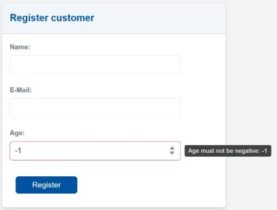
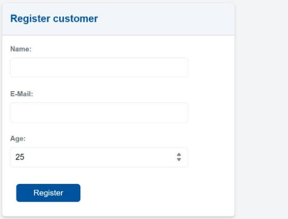

# OCL GUI Validity Checking

!!! abstract "In this chapter"
    - write an OCL invariant for a domain class
    - see MontiGem connect it to the matching input field
    - files you touch: `models/ocl/CustomerValidity.ocl`

MontiGem can use OCL (Object Constraint Language) invariants to validate values
that application users enter in GUI components. This is useful for domain rules
that should be kept close to the data model, but should still be visible
directly in a form.

In this chapter we add a validation rule for customer registration:

- the customer age must not be negative,
- the `Age` input in `CustomerCreate` should be marked invalid when the value
  violates that rule,
- the tooltip should show an application-specific error message.

The important part for application developers is that the GUI model does not
need custom validation code. If a `GemTextInput` is bound to an attribute via
`entry = customer.age`, MontiGem connects OCL constraint violations on that
attribute to the input component.

## Adding an OCL model

Create a new folder `models/ocl` and add the following file:

```java title="models/ocl/CustomerValidity.ocl"
package validity;

import Carrental.*;

ocl CustomerValidity {
  context Customer customer inv:
    customer.age >= 0;
    shortError: "Age must not be negative: " + customer.age;
    error: "The customer age must be zero or greater, but is " + customer.age;
}
```

The file has the usual structure:

- `context Customer customer inv:` declares that the following expression
  validates a `Customer`.
- `customer.age >= 0` is the actual rule.
- `shortError` is the message shown close to the invalid GUI input, for example
  in the tooltip.
- `error` is the longer message used for the full constraint violation.

Both messages are mandatory. The short error should be concise and specific
enough for a user to fix the input without reading technical details.

!!! note
    MontiGem picks up every `.ocl` file in `models/ocl/` automatically.

## Regenerating the code

The generator does not see new files yet. Run the generation once with
`--rerun-tasks`:

```sh
./gradlew :backend:umlp2java --rerun-tasks
```

Then restart the backend and update the frontend:

```sh
./gradlew :frontend:generate
```

While `generate` runs, the frontend console may show a red `TS2740` error for
a moment. It disappears when the build is complete.

The generator now produces a class `carrental.validity.CustomerValidity` in the
backend and in the frontend, and the generated `Customer` class calls it. You can
check that in `backend/build/ocl2java/carrental/validity/CustomerValidity.java`.

!!! note
    Later edits of an existing `.ocl` file are picked up like any other model
    change: restart the backend and run `./gradlew :frontend:generate`.

## Connecting the rule to a GUI input

The existing `CustomerCreate` component already binds the input fields to the
`Customer` attributes:

```ts title="frontend/src/main/gui/gui/CustomerCreate.gui"
component CustomerCreate(Customer customer) {
  @GemCard(title = "Register customer", component = @GemColumn(width = "40ch", rowGap = "5px", components = [
    name@GemTextInput(labelText = "Name: ", entry = customer.name),
    email@GemTextInput(labelText = "E-Mail: ", entry = customer.email),
    age@GemTextInput(labelText = "Age: ", inputType = "number", entry = customer.age),
    register@GemButton(label = "Register", leftClick = createCustomer(customer))
  ]));
}
```

The relevant line is:

```ts
age@GemTextInput(labelText = "Age: ", inputType = "number", entry = customer.age)
```

The `entry` binding is enough for the generated GUI validity handling to relate
the input to `Customer.age`.

!!! note "Scope of the automatic check"
    The automatic check works for input components that are bound with `entry`,
    such as `GemTextInput`. If you set the `validity` parameter of such a
    component yourself, your own check replaces the automatic one.

!!! warning "The input is marked, saving is not blocked"
    Validity checking marks the field and shows the message. It does not prevent
    the app from storing the value. If a rule must never be violated, check it
    in the command or the service that writes the data.

## Trying it out

After starting the application, navigate to `Customer overview` and enter `-1`
in the `Age` field of the customer registration card: type `1`, then put a
minus sign in front of it. The input is marked as invalid and on hover shows:

```
Age must not be negative: -1
```



!!! note "Where did the minus go?"
    If you type the minus sign first, the field sometimes swallows it and
    shows `1`. Typing the digit first avoids this.

Change the value back to `0` or a positive number. The validity error
disappears.



## Checkpoint

- `backend/build/ocl2java/carrental/validity/CustomerValidity.java` exists.
- Entering `-1` in the `Age` field marks the field and shows the message.
- Entering `0` or a positive number clears the marking.
