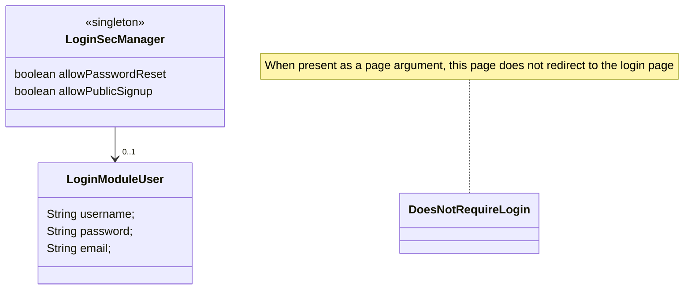
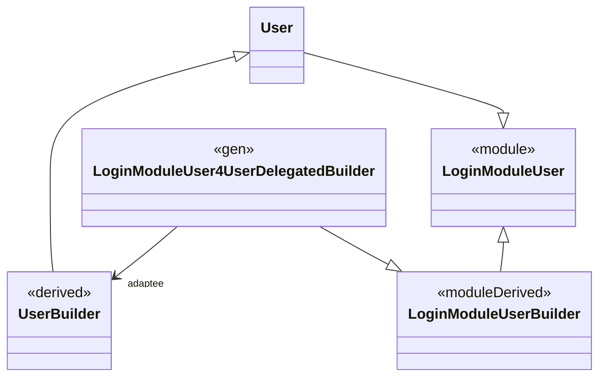

# MontiGem Module System

> ! This file describes an older version.
> Not all aspects of this file work anymore!

Modules provide re-usable $things that can be used in MontiGem applications.
They are able to accomplish this via the following four pillars:

* Modify the MontiGem generator via hook-points (cf. configTemplate)
* Provide (extensible) domain structures (including hand-written domain code)
* Provide hand-written code, such as an email service
* Provide GUI components and pages (including hand-written gui code)

For these purposes, modules "publish" (a subset of) the following artifacts, which are consumed by certain Gradle configurations:
* A generation-time artifact.jar (`montigemModuleGeneratorExtension` configuration / via the `--module-config` CLI option)
* A models.jar (`montigemModuleUMLPModels` configuration/ via the `--modelPath` CLI option), containing the original .cd models to be used with the Domain Generator
* A domain-symbols.jar (`montigemModuleUMLPSymbols` configuration / via the `--path` symbolpath CLI option), containing the CD-symbols to be used with the Gui Generator
* A backend.jar (`implementation` configuration / added to the java classpath), containing the compiled backend sources 
* A ts-module, containing the typescript frontend sources

## Login Module Example

In the following, we will install the Login Module into our Car-Rental application.
The result of this tutorial can be found [online](https://git.rwth-aachen.de/monticore/umlp-anwendungen/car-rental/-/compare/main...login-example).

The login module provides the following class diagram:



And once added & configured,
 access to any data/endpoint requires previous login.
(*Note*: pages with the `DoesNotRequireLogin` parameter still won't be able to load data.
 Users will just not be redirected to the login page)

We start by adding the login module to the backend:
```groovy
// backend/build.gradle
dependencies {
  montigemModule("umlp.modules:login:${mc_version}") // load the login module, consisting of models, config template tool adaption, and implementation/backend dependencies
}
```

The following diagram gives a brief overview of the various Gradle configurations effected by modules.
For example, the domain symbols are loaded as a dependency into the *montigemModuleUMLPSymbols* config,
 which is then used within the GUI generator:
````mermaid
classDiagram
  class montigemModule
  <<unresolveable>> montigemModule
  note for montigemModule  "General definition for a module, can not be directly resolved" 
  class montigemModuleUMLPModels
  montigemModule <|-- montigemModuleUMLPModels
  note for montigemModuleUMLPModels "Contains the models itself -> umlp2ts"
  class montigemModuleGeneratorExtension
  montigemModule <|-- montigemModuleGeneratorExtension
  note for montigemModuleGeneratorExtension "Contains the modifications for the MontiGem tool -> gui2java & umlp2ts"
  class implementation
  montigemModule <|-- implementation
  note for implementation "Contains the compiled backend code -> java"
  class montigemModuleUMLPSymbols
  montigemModule <|-- montigemModuleUMLPSymbols
  note for montigemModuleUMLPSymbols "Contains the domain symbols -> gui2java"
  class montigemModuleFrontendCodeTS
  montigemModule <|-- montigemModuleFrontendCodeTS
  note for montigemModuleFrontendCodeTS "Contains bundles JS-frontend code -> angular"

````


We also have modeled, that the domain classdiagram extends the login module's classdiagram,
 which we accomplish by importing from it:

```cd
// model-components/CustomerService.umlp
import LoginModule.*;
umlp CustomerService {
```

A classdiagram extends every other UMLP classdiagram it imports from,
 either with a star import of the whole diagram (`import LoginModule.*;`)
 or with an import of a single type (`import LoginModule.LoginModuleUser;`).
Imports of Java types or of GUI component types (e.g., `mc.fenix...`) do not extend a classdiagram.
The imports must not form a cycle (error `0x70881`),
 as the generated managers statically delegate to the managers of the extended diagrams.

The [LoginModule.umlp](https://git.rwth-aachen.de/monticore/umlp/-/blob/dev/modules/login/models/LoginModule.umlp?ref_type=heads#L14)  classdiagram is now loaded from the `montigemModuleUMLPModels` configuration.

### Class Diagram Extension Mechanism (Simple)
The Login Module defines a class `LoginModuleUser`,
 which is now available in our application's domain.

Similar to CD merge,
 but hwc is already provided (and loaded into the classpath via the `implementation` configuration).
For example, the `LoginSecManager.getCurrentUserRequest()` command is already implemented.

To actually use domain objects of an extended classdiagram, we have to use that diagrams manager:
For example, we add a default user on startup:

```java
// CarRentalServerApplication.java
  public void init() throws IOException {
    // ...
    if (LoginModuleManager.getLoginModuleUserList().isEmpty()) {
        LoginModuleManager.loginModuleUserBuilder()
            .email("unknown")
            .username("ShadyCarz")
            .password(PasswordEncoderFactories.createDelegatingPasswordEncoder().encode("MyPasswort"))
            .registrationDate(LocalDateTime.now())
            .build();
    }
```

(On this note: Similar to MontiCore Mills, the MontiGem Managers are also adapter to be used with Modules.
Thus, the modules managers do not have to be initialized explicitly.)

### Manual Backend changes
To enable authentication, when using the Login Module, the *src/main/resources/application.properties* files still have to be changed by hand, such as `noAuth` becomes `auth`:
```
// backend/src/main/resources/application.properties
umlp.service.websocket.impl=auth
```

### Backend Tool Modification
(The code/templates of this section can be found within the login module definition)
The login module causes the backend generation to run with the *login_module.backend.LoginBackendConfig.ftl* template:

```ftl
// login-module: LoginBackendConfig.ftl (read-only)
${mod.addModuleToHookpoint("umlp.generator.hook.BeforeTransform",  "login_module.backend.LoginBackend_BeforeTransform")}
```

This template binds the *LoginBackend_BeforeTransform* template to the *BeforeTransform* hookpoint to invoke an additional decorator.

```ftl
// login-module: LoginBackend_BeforeTransform.ftl (read-only)
<#assign decorator = tc.instantiate("login_module.SpringSecurityConfigDecorator", [glex]) />
${decorator.transform(ast, decoratedAST)}
```

This results in the generated *build/umlp/backend/carrental/service/CarRentalSecurityConfig.java* file,
 which sets up various password encoders and the login http endpoint.

### Adding the Login-Module to the Frontend:
Similar to the backend, we also have to add the login module to the frontend as a dependency:

```groovy
// frontend/build.gradle
dependencies {
  montigemModule("umlp.modules:login:$mc_version") // Load generator modifications, domain symbols, models, and the generates frontend ts-files
}
```

(Note: Due to car-rental being a weird project/a workaround for CD2GUI singletons, 
 those lines SHOULD NOT be added after the `gui2java` definition,
as otherwise gradle MIGHT complain about already resolved configurations.)

In addition, the typescript dependency (similar to the backends *implementation* dependency) has to be added.
For a landslide of reasons we are unable to package our frontends as an angular slide (or ALU was just not able to.)
Instead, they are implicitly copied over using the *montigemModuleFrontendCodeTS* configuration.
The angular/TS compiler now has to be made aware of where to find the login module's sources,
 which we can do by adding it as a path to the tsconfig:

```json
// frontend/config/tsconfig.json
"paths": {
 "@src/*": ["build/appdomain/*", "build/appgui/*", "src/app/*", "../../src/app/*", "../umlp/fe2/*",
 "umlp_modules/loginmodule-ts/template_placeholder/src/*"
],
```

***TODO: This notation is about to change!***

*Technical note:* We bundle the frontend files as a zip and extract them via Gradle
 into the `umlp_modules/loginmodule-ts` directory.
Due to the relative template paths, the actual sources are two levels further down (*template_placeholder/src*),
 with the templates also being present in the *umlp_modules/loginmodule-ts/build* directory.
It may be cursed, but it works (we should improve on this, but for now enough time was spent between multiple persons on npm).


### Configuring the Module

Depending on the module, they can be configured in various ways.
For example, the login module can provide public password resets and signups,
 which are disabled by default.

In the case of the login module,
 its `LoginSecManager` class exposes two boolean attributes: 
 `allowPasswordReset` and `allowPublicSignUp`.

```java
@PostConstruct
@Override
public void init() throws IOException {
  LoginModuleManager.getLoginSecManager().setAllowPublicSignUp(true);
```

(Although for now, the email part is not yet implemented.)

### Using the Modules Domain

We can now simply show the current user's username by using it within the gui models:
```gui
import LoginModule.LoginSecManager;

component NavContainer(..., LoginSecManager loginsecmanager) {
  ...
        @GemNavItem(title = "Home ( " + loginsecmanager.signedInUser.username + ")", target = "/gui/Start"),
```

### Extend the Modules Domain

We can simply extend the classes of a module and re-use their definitions.

```cd
  class SecondUserClass extends LoginModuleUser {
    String nickname;
  }
```

Do note: This results in both classes being present.
Thus, instances of both classes are possible.

Instead, we can also replace/"delegate away" all uses of the *LoginModuleUser* class
 using the `<<ConcretizeModule>>` stereotype:

```cd
  <<ConcretizeModule>>
  class User extends LoginModuleUser {
    String nickname; // a required nickname attribute
    AccessRole role; // a required role attribute
  }
```

This results in calls to `LoginModuleManager.loginModuleUserBuilder()` actually returning builders of the new `User` class.

Behind the magic, an adapter Builder class `LoginModuleUser4UserDelegatedBuilder extends LoginModuleUserBuilder` is generated.
(Unfortunately, the class inheritance is not translated onto MontiGem builders)



The login module provides additional hookpoints to "complete" a builder,
 as in case of non-optional attributes added in a non-conservative way,
  `LoginModuleUser4UserDelegatedBuilder.build()` would fail.
For example, 

````java
public class CarRentalServerApplication extends carrental.CarRentalServerApplicationTOP {
  @Autowired
  protected LoginModuleRestService loginModuleRestService;

  @PostConstruct
  @Override
  public void init() throws IOException {

    // For the public Sign up: Ensure the role is set to a default value of USER
    loginModuleRestService.onSignupAdditionals.add((jsonObject, uB) -> {
      ((LoginModuleUser4UserDelegatedBuilder)uB).adaptee.role(DtcockpitRole.USER);
      ((LoginModuleUser4UserDelegatedBuilder)uB).adaptee.nickname(jsonObject.getString("nickname"));
    });
    super.init();
    ...

````

Please note: This functionality must be included by the module developers.

The delegated/adapted builders are currently only generated in the backend
 and have to be manually TOPed in the frontend.

### Notes on CD-Merge / CD Concretization

A CD-Merge / CD-Concretization approach was considered as an alternative, but not suitable due to the code adaption:
 1. trace relocations (e.g., loginModule.User -> autovermietung.Benutzer)
 2. adapt hand-written models (e.g., GUI pages or transitive module usages with their domain models)
    * Concretization of GUI models to CDs 
 3. adapt hand-written GUI-TS/Java Code (e.g., the login page)
 4. include relocation-information within templates (e.g., redirect if not logged in)
 5. Concretization Completitin is also in development.


### Extend the Modules GUI
Further work has to be made to extend GUI Pages.

For now, it is only possible to re-use the gui components (Such as UserCreate, etc.) of the module.
In the case, that non-conservative extensions to a class are made (such as a required phone number),
 the creators (such as the SignUp page) has to be adapted too,
 which currently means a CTRL+C/CTRL+V of the modules gui definitions.


## A quick note on the frontend deployment:
* We are unable to publish it as an angular library due to ambiguity: 
> projects/loginmodule-ts/src/public-api.ts:102:1 - error TS2308: Module './gui/loginmodule/comp/LoginContainerComponent' has already exported a member named 'config'. Consider explicitly re-exporting to resolve the ambiguity.

* Using subproject (for each file) also does not work due to circular dependencies

* Instead, we distribute the packaged umlp2ts/gui2java outpu
