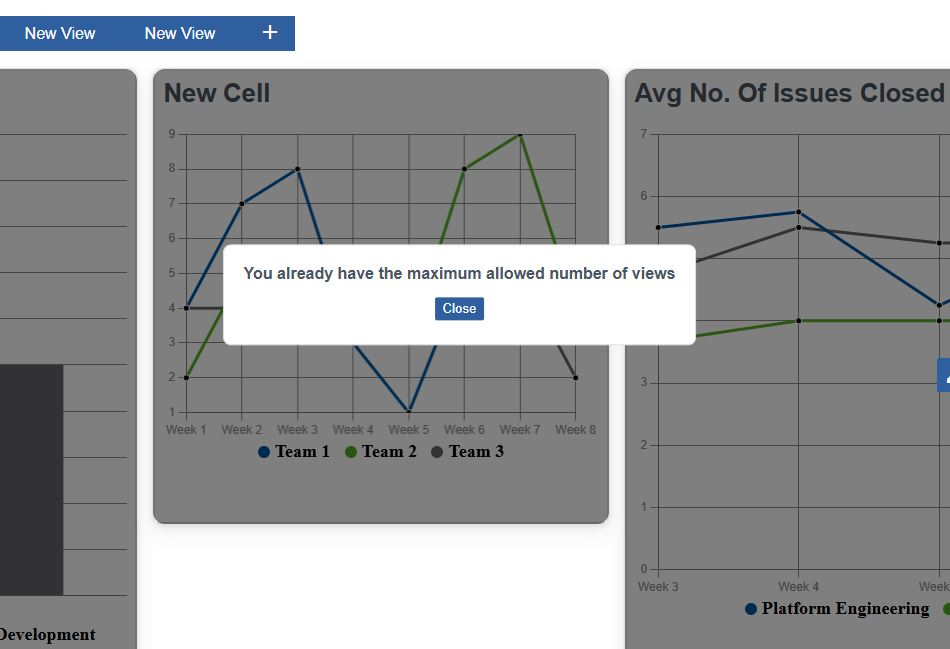

# Dialog Components

In this part every dialog component used in the dashboard component is discussed and described.
Since at the current state no dialog component is included in the MontiGem component library,
each of these were build from scratch and implemented separately, not using any generic dialog
component. This was done as, for the scope of the project, creating a MontiGem dialog component
on the level of integration of the other components would not be realistically possible. In the
future when such a component becomes available a refactoring of the dialogs to use it in order
to maintain consistency of the project with the entire MontiGem project and other side projects.

## [CellDialog](https://git.rwth-aachen.de/monticore/umlp/-/blob/ma-kapidani-clean/examples/dashboard/frontend/src/main/gui/components/CellDialog.gui?ref_type=heads)

Handles both creation and editing of the cells and depending on the state of the dashboard
checked through the inherited corresponding boolean parameter *edit* adapts its layout and
functionality. Its Layout is made out of a tabs upper section (only available in editing mode),
the content section, and the lower button section. Used in the *[View](https://git.rwth-aachen.de/monticore/umlp/-/blob/ma-kapidani-clean/examples/dashboard/frontend/src/main/gui/components/View.gui?ref_type=heads)* component.

The content section is the only one that remains the same despite the mode the *[CellDialog](https://git.rwth-aachen.de/monticore/umlp/-/blob/ma-kapidani-clean/examples/dashboard/frontend/src/main/gui/components/CellDialog.gui?ref_type=heads)* is
in. It is made out of the *[MainCellOptions](https://git.rwth-aachen.de/monticore/umlp/-/blob/ma-kapidani-clean/examples/dashboard/frontend/src/main/gui/components/MainCellOptions.gui?ref_type=heads)* and *[ExtraCellOptions](https://git.rwth-aachen.de/monticore/umlp/-/blob/ma-kapidani-clean/examples/dashboard/frontend/src/main/gui/components/ExtraCellOptions.gui?ref_type=heads)* component. In the
*[MainCellOptions](https://git.rwth-aachen.de/monticore/umlp/-/blob/ma-kapidani-clean/examples/dashboard/frontend/src/main/gui/components/MainCellOptions.gui?ref_type=heads)* users are allowed to set/change the basic attributes of the "[CellConfig](https://git.rwth-aachen.de/monticore/umlp/-/blob/ma-kapidani-clean/examples/dashboard/models/Dashboard.umlp?ref_type=heads)": name,
visualization type (*viz* attribute), and data. Meanwhile in *[ExtraCellOptions](https://git.rwth-aachen.de/monticore/umlp/-/blob/ma-kapidani-clean/examples/dashboard/frontend/src/main/gui/components/ExtraCellOptions.gui?ref_type=heads)* users set/change
the other parameter sof the visualization component that are stored in the corresponding
*[ExtraData](https://git.rwth-aachen.de/monticore/umlp/-/blob/ma-kapidani-clean/examples/dashboard/models/Dashboard.umlp?ref_type=heads)* class attribute in *[CellConfig](https://git.rwth-aachen.de/monticore/umlp/-/blob/ma-kapidani-clean/examples/dashboard/models/Dashboard.umlp?ref_type=heads)*. For all attributes we use the simple input component
from the MontiGem library, which offer variable value synchronization, except for the case of "data"
, where we use the *MonacoEditor* component to offer a more code editor experience to the user

The *[ExtraCellOptions](https://git.rwth-aachen.de/monticore/umlp/-/blob/ma-kapidani-clean/examples/dashboard/frontend/src/main/gui/components/ExtraCellOptions.gui?ref_type=heads)* component itself just checks on the visualization type and initializes the
right corresponding ExtraOptions component. In almost all of these specific ExtraOptions
components, overriding of the generated getter/setters functions of the input MontiGem
library components is necessary. Currently JSweet translation of the Java attribute value of Optional
results in undefined which lead to errors in TypeScript. Such to allow the users to set a neutral "empty"
value proxy values need to be implemented and then be correctly read through overriding in the
Java TOP extension. Important if new visualizations are added for a corresponding specific ExtraCellOptions component 
to be created and added to the @guard cases in the main *[ExtraCellOptions](https://git.rwth-aachen.de/monticore/umlp/-/blob/ma-kapidani-clean/examples/dashboard/frontend/src/main/gui/components/ExtraCellOptions.gui?ref_type=heads)*

In both modes and for both set of options the
*[CellDialog](https://git.rwth-aachen.de/monticore/umlp/-/blob/ma-kapidani-clean/examples/dashboard/frontend/src/main/gui/components/CellDialog.gui?ref_type=heads)* component checks if the data is valid through the corresponding functions
in the [Java TOP extension](https://git.rwth-aachen.de/monticore/umlp/-/blob/ma-kapidani-clean/examples/dashboard/frontend/src/main/java/components/CellDialog.java?ref_type=heads) *checkCellMain()* and *checkCellExtra()*. In the case of
*checkCellExtra()* the function actually checks the visualization type and calls upon the
corresponding checkExtra() function. Important that if new visualizations are added that their extra data is checked also and for that
a new fucntion and case is added to the existing ones. If the values are in order the functions return "positive",
otherwise with an error message. The checking function than sets the "message" parameter
of the *[CellDialog](https://git.rwth-aachen.de/monticore/umlp/-/blob/ma-kapidani-clean/examples/dashboard/frontend/src/main/gui/components/CellDialog.gui?ref_type=heads)* component to that error message and triggers the boolean flag "error"
for the error text to be visible.

In the case the *[CellDialog](https://git.rwth-aachen.de/monticore/umlp/-/blob/ma-kapidani-clean/examples/dashboard/frontend/src/main/gui/components/CellDialog.gui?ref_type=heads)* component is called in creation mode, the 2 options components are
shown in order can be navigated through the buttons in the lower section. So each options
component represents a step in cell creation. This step is recognized through the boolean
parameter *first*. In this mode the checks to the values input by the user are checked in each
step separately.

If the *[CellDialog](https://git.rwth-aachen.de/monticore/umlp/-/blob/ma-kapidani-clean/examples/dashboard/frontend/src/main/gui/components/CellDialog.gui?ref_type=heads)* component is called in editing mode the 2 options can be navigated
through the tabs in the only in this mode available top section. In this case the checks
are done all together when the user ends the dialog interaction.

The bottom button section adapts in functionality depending on the mode too. In creation mode
there is a button always to abort the creation entirely, throwing away the data, and a button to
go to the next step or to finish creation depending on the current step. In editing mode there is
a save button which permanently saves and changes the corresponding value in the cell's
*[CellConfig](https://git.rwth-aachen.de/monticore/umlp/-/blob/ma-kapidani-clean/examples/dashboard/models/Dashboard.umlp?ref_type=heads)* and again an abort button, but in this case it only throws away the changes to the
original values when the dialog was first opened.

This is done through a [CellConfig](https://git.rwth-aachen.de/monticore/umlp/-/blob/ma-kapidani-clean/examples/dashboard/models/Dashboard.umlp?ref_type=heads) parameter *cellForEdit*. Instead of transmitting the changes
to the original cell's *[CellConfig](https://git.rwth-aachen.de/monticore/umlp/-/blob/ma-kapidani-clean/examples/dashboard/models/Dashboard.umlp?ref_type=heads)* we create a temporary "empty" *[CellConfig](https://git.rwth-aachen.de/monticore/umlp/-/blob/ma-kapidani-clean/examples/dashboard/models/Dashboard.umlp?ref_type=heads)* when initializing
the component in editing mode in the *[View](https://git.rwth-aachen.de/monticore/umlp/-/blob/ma-kapidani-clean/examples/dashboard/frontend/src/main/gui/components/View.gui?ref_type=heads)* component. And only when we execute the function of
the save button do we actually transmit those changes to the original *[CellConfig](https://git.rwth-aachen.de/monticore/umlp/-/blob/ma-kapidani-clean/examples/dashboard/models/Dashboard.umlp?ref_type=heads)*. In both cases
this temporary *[CellConfig](https://git.rwth-aachen.de/monticore/umlp/-/blob/ma-kapidani-clean/examples/dashboard/models/Dashboard.umlp?ref_type=heads)* is deleted after the dialog is finished.

## [InfoDialog](https://git.rwth-aachen.de/monticore/umlp/-/blob/ma-kapidani-clean/examples/dashboard/frontend/src/main/gui/components/InfoDialog.gui?ref_type=heads)

A simple dialog component with only relevant String parameter of *info*, which is the text
the dialog with display. Used in *[Dashboard](https://git.rwth-aachen.de/monticore/umlp/-/blob/ma-kapidani-clean/examples/dashboard/frontend/src/main/gui/components/Dashboard.gui?ref_type=heads)* component.

## [DeleteDialog](https://git.rwth-aachen.de/monticore/umlp/-/blob/ma-kapidani-clean/examples/dashboard/frontend/src/main/gui/components/DeleteDialog.gui?ref_type=heads)

A simple dialog component to serve as a protection step to prevent unintended deletes of cells.
Displays a static reassurance question and has 2 buttons, one to abort deletion and one that
executes the deletion function. Used in the *[Cell](https://git.rwth-aachen.de/monticore/umlp/-/blob/ma-kapidani-clean/examples/dashboard/frontend/src/main/gui/components/Cell.gui?ref_type=heads)* Component.

## [ViewDialog](https://git.rwth-aachen.de/monticore/umlp/-/blob/ma-kapidani-clean/examples/dashboard/frontend/src/main/gui/components/ViewDialog.gui?ref_type=heads)

Opens when the user tries to create a new view. Features an option for a preset that the user can choose from.
Always a blank option included. The user can choose to close the dialog and terminate the view creation process
or create the view after choosing one through the 2 corresponding button in the bottom. Each
preset has an id *index* and an image source path to display a preview of the preset to the user.
When the user chooses an option and presses the create button, a corresponding function to
that options index is executed via a function *createNewView()* defined and inherited from the upper level component
it is used in, *[Dashboard](https://git.rwth-aachen.de/monticore/umlp/-/blob/ma-kapidani-clean/examples/dashboard/frontend/src/main/gui/components/Dashboard.gui?ref_type=heads)*. The function depending on the preset it gets created the list of cells
in the *[ViewConfig](https://git.rwth-aachen.de/monticore/umlp/-/blob/ma-kapidani-clean/examples/dashboard/models/Dashboard.umlp?ref_type=heads)* of the new view using a different corresponding function, again defined in *[Dashboard](https://git.rwth-aachen.de/monticore/umlp/-/blob/ma-kapidani-clean/examples/dashboard/frontend/src/main/gui/components/Dashboard.gui?ref_type=heads)*.

## [TutorialDialog](https://git.rwth-aachen.de/monticore/umlp/-/blob/ma-kapidani-clean/examples/dashboard/frontend/src/main/gui/components/TutorialDialog.gui?ref_type=heads)

A simple dialog that accompanies each tutorial step and shows its corresponding instruction text
Depending on the property of the tutorial step it can feature a button to move on to the next step
and can have 2 different positions in order to adjust to other dialogs that may be opened
simultaneously in the screen. Used in the *[Dashboard](https://git.rwth-aachen.de/monticore/umlp/-/blob/ma-kapidani-clean/examples/dashboard/frontend/src/main/gui/components/Dashboard.gui?ref_type=heads)*
component.

The list of tutorial steps is defined in *[Dashboard](https://git.rwth-aachen.de/monticore/umlp/-/blob/ma-kapidani-clean/examples/dashboard/frontend/src/main/gui/components/Dashboard.gui?ref_type=heads)* in order to pass down the list easily to every other component.
Each instruction has Strings *instruction* and *section* for information to be shown by the [TutorialDialog](https://git.rwth-aachen.de/monticore/umlp/-/blob/ma-kapidani-clean/examples/dashboard/frontend/src/main/gui/components/TutorialDialog.gui?ref_type=heads),
and booleans *hasButton*, *hasBackdrop*, and *bottom* to change the dialogs positioning and if the tutorial has
a dedicated next button for that step.

In order to implement specific css overwriting and functionality changes like button locking
, there are in almost every component's Gui files specific steps @if statements.This is done
to implement visual cues for the user when following the tutorial and to maintain sequence of the
tutorial. The unfortunate side effect is that it produces a lot of duplicate code that can be overwhelming,
but for the main version of the component look for the @else part in case of a tutorial step conditional statement.

Thanks to tutorial steps having *ids*, we can use the steps arrangement in the list to show us
the order of the steps. This makes it easier to add or change steps in the array as adding or removing
one step does not mean a reformatting of the whole list and of all affected tutorial conditional
statements in other components.
