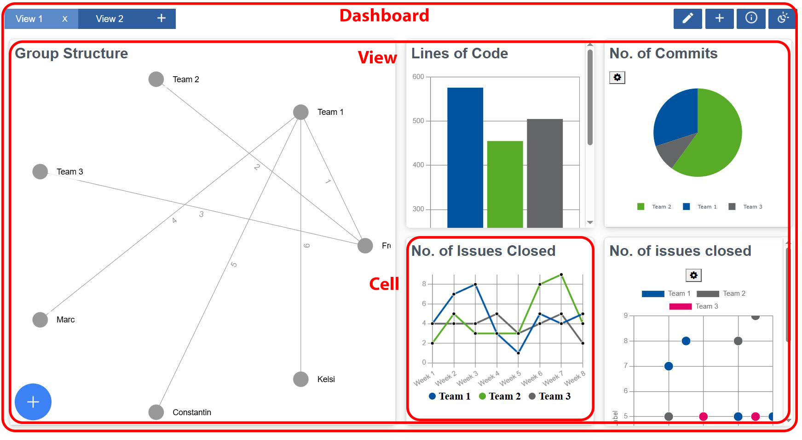
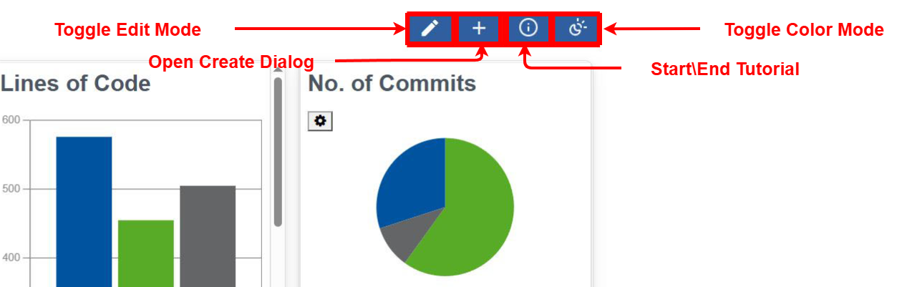
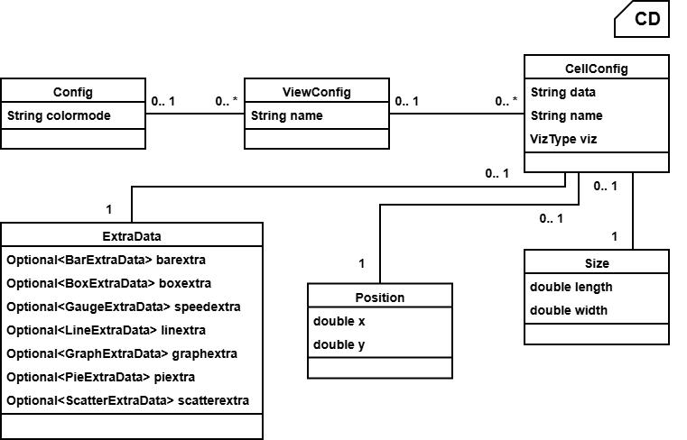
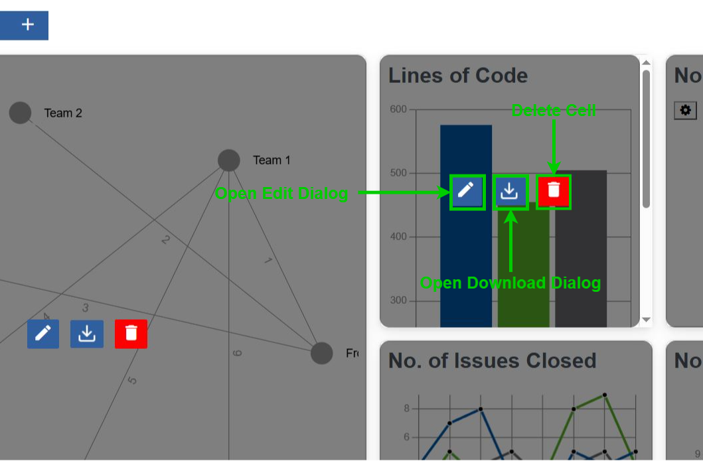

# General Structure

The dashboard contains 3 main components/parts:

1. **[Dashboard](https://git.rwth-aachen.de/monticore/umlp/-/blob/ma-kapidani-clean/examples/dashboard/frontend/src/main/gui/components/Dashboard.gui?ref_type=heads)**: encompasses the entire dashboard component
2. **[View](https://git.rwth-aachen.de/monticore/umlp/-/blob/ma-kapidani-clean/examples/dashboard/frontend/src/main/gui/components/View.gui?ref_type=heads)**: a container for multiple cells which within the larger dashboard component can represent a
   dashboard of its own or a self coherent part of a dashboard; visually represented by the tabs on the top left
3. **[Cell](https://git.rwth-aachen.de/monticore/umlp/-/blob/ma-kapidani-clean/examples/dashboard/frontend/src/main/gui/components/Cell.gui?ref_type=heads)**: a wrapper/container for each individual visualization; visually represented by the widget-like
   movable and resizable container under a view

For each of these main components there is a corresponding configuration class in the model file namingly:
*[Config](https://git.rwth-aachen.de/monticore/umlp/-/blob/ma-kapidani-clean/examples/dashboard/models/Dashboard.umlp?ref_type=heads)*, *[ViewConfig](https://git.rwth-aachen.de/monticore/umlp/-/blob/ma-kapidani-clean/examples/dashboard/models/Dashboard.umlp?ref_type=heads)*, and *[CellConfig](https://git.rwth-aachen.de/monticore/umlp/-/blob/ma-kapidani-clean/examples/dashboard/models/Dashboard.umlp?ref_type=heads)*.

In *[Config](https://git.rwth-aachen.de/monticore/umlp/-/blob/ma-kapidani-clean/examples/dashboard/models/Dashboard.umlp?ref_type=heads)* you can find the String attribute for the color mode(at the moment just dark mode) and the list
of total views.

In *[ViewConfig](https://git.rwth-aachen.de/monticore/umlp/-/blob/ma-kapidani-clean/examples/dashboard/models/Dashboard.umlp?ref_type=heads)* you can find a display name attribute and the list of its corresponding cells.

Lastly in *[CellConfig](https://git.rwth-aachen.de/monticore/umlp/-/blob/ma-kapidani-clean/examples/dashboard/models/Dashboard.umlp?ref_type=heads)* you have also a display name, an enum for the type of visualization *viz*, a String to
hold the data for the visualization  *data* and an instance of the *[ExtraData](https://git.rwth-aachen.de/monticore/umlp/-/blob/ma-kapidani-clean/examples/dashboard/models/Dashboard.umlp?ref_type=heads)* class to hold all the values for
the other attributes configurable for the visualization *extra*.

*[ExtraData](https://git.rwth-aachen.de/monticore/umlp/-/blob/ma-kapidani-clean/examples/dashboard/models/Dashboard.umlp?ref_type=heads)* is just a super class that holds an optional instance of the specific *[ExtraData](https://git.rwth-aachen.de/monticore/umlp/-/blob/ma-kapidani-clean/examples/dashboard/models/Dashboard.umlp?ref_type=heads)* class of each
visualization supported. In each of these specific *[ExtraData](https://git.rwth-aachen.de/monticore/umlp/-/blob/ma-kapidani-clean/examples/dashboard/models/Dashboard.umlp?ref_type=heads)* classes the properties of the component of
the corresponding visualization are mapped. For example in the pie chart visualization component the only
additional property to *data* is the *innerRadius* which you will find also in the *[PieExtraData](https://git.rwth-aachen.de/monticore/umlp/-/blob/ma-kapidani-clean/examples/dashboard/models/Dashboard.umlp?ref_type=heads)* class
definition. Inportant in case new visualizations are added for corresponding *[ExtraData](https://git.rwth-aachen.de/monticore/umlp/-/blob/ma-kapidani-clean/examples/dashboard/models/Dashboard.umlp?ref_type=heads)* classes to be created which
attributes map to the additional parameters of the corresponding visualization component 

Here is a full class diagram of the dashboard component data structure:

Next is a short description of the components corresponding to these 3 main parts.

**[Dashboard](https://git.rwth-aachen.de/monticore/umlp/-/blob/ma-kapidani-clean/examples/dashboard/frontend/src/main/gui/components/Dashboard.gui?ref_type=heads)** component

Frontend it defines the utility top bar which contains on the left the view tabs to switch the
current view showing and ont he right buttons to activate core functionality like editing, creating, starting
the tutorial, and changing the color mode. as such in the [corresponding Java TOP extension file](https://git.rwth-aachen.de/monticore/umlp/-/blob/ma-kapidani-clean/examples/dashboard/frontend/src/main/java/components/Dashboard.java?ref_type=heads) you can find
mainly functions related to assist that functionality. More details of those are found in their corresponding
parts in the other chapters. Additionally, it contains some dialogs:

- *[InfoDialog](https://git.rwth-aachen.de/monticore/umlp/-/blob/ma-kapidani-clean/examples/dashboard/frontend/src/main/gui/components/InfoDialog.gui?ref_type=heads)* - inform user that they have hit the maximum number of simultaneous views allowed
- *[DeleteDialog](https://git.rwth-aachen.de/monticore/umlp/-/blob/ma-kapidani-clean/examples/dashboard/frontend/src/main/gui/components/DeleteDialog.gui?ref_type=heads)* - to confirm the deletion of a view so the user does not accidentally delete
- *[TutorialDialog](https://git.rwth-aachen.de/monticore/umlp/-/blob/ma-kapidani-clean/examples/dashboard/frontend/src/main/gui/components/TutorialDialog.gui?ref_type=heads)* - to give the current tutorial step's direction/instruction

*INSERT PICTURE TO MARK AND SHOW EACH BUTTON/FUNCTIONALITY*

Since this is the highest level component, here you can find the first declaration of boolean properties:

- *edit* - is resizing/moving of cells allowed
- *createCell* - is the creation version of the *[CellDialog](https://git.rwth-aachen.de/monticore/umlp/-/blob/ma-kapidani-clean/examples/dashboard/frontend/src/main/gui/components/CellDialog.gui?ref_type=heads)* open
- *editCellFlag* - is the editing version of the *[CellDialog](https://git.rwth-aachen.de/monticore/umlp/-/blob/ma-kapidani-clean/examples/dashboard/frontend/src/main/gui/components/CellDialog.gui?ref_type=heads)* open
- *download* - is *[DownloadDialog](https://git.rwth-aachen.de/monticore/umlp/-/blob/ma-kapidani-clean/examples/dashboard/frontend/src/main/gui/components/DownloadDialog.gui?ref_type=heads)* open
- *night* - is the dashboard in dark mode
- *running* - is the dashboard currently loading a view
- *info* - is *[InfoDialog](https://git.rwth-aachen.de/monticore/umlp/-/blob/ma-kapidani-clean/examples/dashboard/frontend/src/main/gui/components/InfoDialog.gui?ref_type=heads)* open

and counters:

- *currentView* - currently displayed view
- *tutorialStep* - current tutorial step (value 0 means tutorial is off)
- *currentCellId* - the GemId of the cell currently in focus being edited

that keep track of the state for the dashboard and its dialogs. For some of them despite not being used directly
for functionality in this level of the component, it is important to still have their main starting point here in
order to restrict UI-wise the users activity to not create component breaking user interactions. An example is
*checkIfDialogOpen* to disable all dialog trigger buttons when a dialog is already open so not allow layers of
overlapping conflicting dialogs to be opened by the user.

**[View](https://git.rwth-aachen.de/monticore/umlp/-/blob/ma-kapidani-clean/examples/dashboard/frontend/src/main/gui/components/View.gui?ref_type=heads)** component

Currently it is mainly a wrapper for the *GridStack* component that handles the actual resizing and moving
of the cells. That component is elaborated on in its own part. Also, it contains the remaining dialog and most
important one, *[CellDialog](https://git.rwth-aachen.de/monticore/umlp/-/blob/ma-kapidani-clean/examples/dashboard/frontend/src/main/gui/components/CellDialog.gui?ref_type=heads)*, that allows editing and/or creating cells.

**[Cell](https://git.rwth-aachen.de/monticore/umlp/-/blob/ma-kapidani-clean/examples/dashboard/frontend/src/main/gui/components/Cell.gui?ref_type=heads)** component

Holds the *[CellDisplay](https://git.rwth-aachen.de/monticore/umlp/-/blob/ma-kapidani-clean/examples/dashboard/frontend/src/main/gui/components/CellDisplay.gui?ref_type=heads)* component, which loads the correct visualization component depending on the value of
*viz* in the *[CellConfig](https://git.rwth-aachen.de/monticore/umlp/-/blob/ma-kapidani-clean/examples/dashboard/models/Dashboard.umlp?ref_type=heads)* and assigns the correct properties to it from *extra*. Also contains buttons to trigger
these dialog openings for their corresponding functionalities: *[DownloadDialog](https://git.rwth-aachen.de/monticore/umlp/-/blob/ma-kapidani-clean/examples/dashboard/frontend/src/main/gui/components/DownloadDialog.gui?ref_type=heads)*  (downloading/exporting),
*[CellDialog](https://git.rwth-aachen.de/monticore/umlp/-/blob/ma-kapidani-clean/examples/dashboard/frontend/src/main/gui/components/CellDialog.gui?ref_type=heads)* (editing the cell properties), and *[DeleteDialog](https://git.rwth-aachen.de/monticore/umlp/-/blob/ma-kapidani-clean/examples/dashboard/frontend/src/main/gui/components/DeleteDialog.gui?ref_type=heads)* (deleting the cell).

The *[CellDisplay](https://git.rwth-aachen.de/monticore/umlp/-/blob/ma-kapidani-clean/examples/dashboard/frontend/src/main/gui/components/CellDisplay.gui?ref_type=heads)* component needs to be extended with additional @guard statements for new visualizations if such are added

