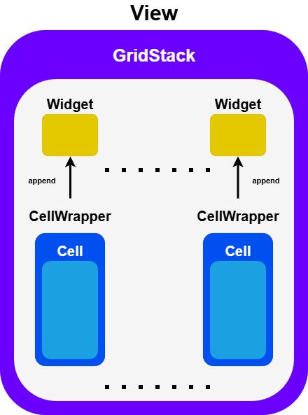

# GridStack

Currently the MontiGem component library offers no dynamic container component that allows for
resizing and/or moving of its inner components. Such now we are using an external javascript library GridStack.
In order to use the library the GridStack container component needs to be fully implemented though custom TypeScript
implementation. We still have the basic GUI file to declare the parameters but all the logic is contained within the file
*[GridStackComp.ts](https://git.rwth-aachen.de/monticore/umlp/-/blob/ma-kapidani-clean/examples/dashboard/frontend/src/main/gui/components/GridStackComp.ts?ref_type=heads)*.

In *[GridStackComp.ts](https://git.rwth-aachen.de/monticore/umlp/-/blob/ma-kapidani-clean/examples/dashboard/frontend/src/main/gui/components/GridStackComp.ts?ref_type=heads)* first we declare observes that allow the component to dynamically react and recognize changes to their values.
Next we declare the *reactOnViewInputChange()* method to which we connected the observes with as the function to be
executed when values of the parameters of GridStack change. *GridStack* operates through *widgets*, but these *widgets* are just HTML elements
and not Angular components. So we have created an intermediate component *CellWrapper* to connect each
*widget* with its corresponding *[Cell](https://git.rwth-aachen.de/monticore/umlp/-/blob/ma-kapidani-clean/examples/dashboard/frontend/src/main/gui/components/Cell.gui?ref_type=heads)* component. Then this *CellWrapper* is appended to the *GridStack* *widget* and all the
parameters of the *[CellConfig](https://git.rwth-aachen.de/monticore/umlp/-/blob/ma-kapidani-clean/examples/dashboard/models/Dashboard.umlp?ref_type=heads)* from list of the view are attached to the mapped parameters of the *CellWrapper*.

The problem here is that each *widget*, especially when resizing or moving does not synchronize automatically
with the corresponding *[CellConfig](https://git.rwth-aachen.de/monticore/umlp/-/blob/ma-kapidani-clean/examples/dashboard/models/Dashboard.umlp?ref_type=heads)* attributes and more broadly the list of *widgets* does not synchronize
with the list of *[CellConfig](https://git.rwth-aachen.de/monticore/umlp/-/blob/ma-kapidani-clean/examples/dashboard/models/Dashboard.umlp?ref_type=heads)*'s in the *[ViewConfig](https://git.rwth-aachen.de/monticore/umlp/-/blob/ma-kapidani-clean/examples/dashboard/models/Dashboard.umlp?ref_type=heads)* of the *GridStack*. This means that changes done by the user
are not saved in the config objects and a simple reloading of the component or view would permanently remove them. As such we implemented
our own synchronization in the *reactOnViewInputChange()* method.

First we keep track of the history of *widgets* and *CellConfigs*, assigning ids to the *widgets* to be able to connected them to their cell counterpart.
And we keep track of the history of the 2 most critical
state values, edit and create, so on state changes of the dashboard, we can compare and synchronize appropriately.
Next with our design of the dashboard and recording of its state 4 distinct cases of synchronization were observed.

1. **initial call** - When a view is first selected by the user, cells are loaded for the first time
   and the history in GridStack is empty. In such a case new *widgets* are created and appended and connected
   to *[Cell](https://git.rwth-aachen.de/monticore/umlp/-/blob/ma-kapidani-clean/examples/dashboard/frontend/src/main/gui/components/Cell.gui?ref_type=heads)* components as described above through the function *createWidget()*

2. **cell created** - When a new cell is created by the user. The new cell is located by comparing hte last saved state of the *[CellConfig](https://git.rwth-aachen.de/monticore/umlp/-/blob/ma-kapidani-clean/examples/dashboard/models/Dashboard.umlp?ref_type=heads)* list
   with the new one just received by the trigger of the state change. A new *widget* is created for it with the same function *createWidget()*.

3. **cells edited** - When the user is finished with editing the cells. All the new positions and sizes for each cell need to be saved.
   For each cell in the list, we find its corresponding *widget* through id matching and than save all of the *widget*'s values on position and size in the *[CellConfig](https://git.rwth-aachen.de/monticore/umlp/-/blob/ma-kapidani-clean/examples/dashboard/models/Dashboard.umlp?ref_type=heads)* of the cell
   All of this is done through the function *synchronizeWidgetToCell*.

4. **cell deletion** - When the user deletes a cell. When creating the *widgets* we assign to create and transmit to each *[Cell](https://git.rwth-aachen.de/monticore/umlp/-/blob/ma-kapidani-clean/examples/dashboard/frontend/src/main/gui/components/Cell.gui?ref_type=heads)* component a *widget* deletion function, such that when the user deletes a cell, we can accept this function
   after deleting its corresponding *[CellConfig](https://git.rwth-aachen.de/monticore/umlp/-/blob/ma-kapidani-clean/examples/dashboard/models/Dashboard.umlp?ref_type=heads)* and so the change is instantaneous and does require a special case in *reactOnViewInputChange()*.

Additionally we synchronize the function *reactOnViewInputChange()* with runs of itself in case new changes to the component parameters trigger too fast and new function calls start rushing before the last call is over. This if not handled leads to undesired
results where cells are displayed multiple times in the view to the user or arranged because of the multiple items with the same coordinates, in ugly and random positions in the grid.
To prevent this a semaphore system is implemented through the state boolean variable *running*. While *running* is true so the function is running
we disable the user form pressing buttons that could trigger new state value chnages and so new function calls for *reactOnViewInputChange()*
